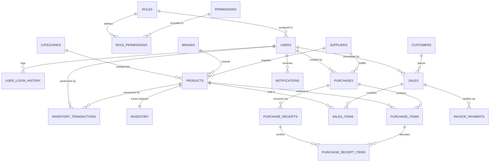

# StockForge Database Schema & Data Dictionary

Comprehensive database architecture, entity-relationship models, and page-by-page table/column mappings for the **StockForge Inventory Management System**.

---

## Table of Contents
1. [Architecture Overview & Conventions](#1-architecture-overview--conventions)
2. [Complete Entity-Relationship (ER) Diagram](#2-complete-entity-relationship-er-diagram)
3. [Page-to-Table Mapping Matrix](#3-page-to-table-mapping-matrix)
4. [Module 1: Authentication & User Management](#4-module-1-authentication--user-management)
   - [Roles Table (`dbo.Roles`)](#roles-table-dboroles)
   - [Permissions Table (`dbo.Permissions`)](#permissions-table-dbopermissions)
   - [Role Permissions Table (`dbo.RolePermissions`)](#role-permissions-table-dborolepermissions)
   - [Users Table (`dbo.Users`)](#users-table-dbousers)
   - [User Login History (`dbo.UserLoginHistory`)](#user-login-history-dbouserloginhistory)
   - [Password Reset Tokens (`dbo.PasswordResetTokens`)](#password-reset-tokens-dbopasswordresettokens)
5. [Module 2: Product Catalog & Inventory](#5-module-2-product-catalog--inventory)
   - [Categories Table (`dbo.Categories`)](#categories-table-dbocategories)
   - [Brands Table (`dbo.Brands`)](#brands-table-dbobrands)
   - [Products Table (`dbo.Products`)](#products-table-dboproducts)
   - [Inventory Table (`dbo.Inventory`)](#inventory-table-dboinventory)
   - [Inventory Transactions Table (`dbo.InventoryTransactions`)](#inventory-transactions-table-dboinventorytransactions)
6. [Module 3: Suppliers & Procurement](#6-module-3-suppliers--procurement)
   - [Suppliers Table (`dbo.Suppliers`)](#suppliers-table-dbosuppliers)
   - [Purchase Orders Table (`dbo.Purchases`)](#purchase-orders-table-dbopurchases)
   - [Purchase Line Items Table (`dbo.PurchaseItems`)](#purchase-line-items-table-dbopurchaseitems)
   - [Purchase Receipts Table (`dbo.PurchaseReceipts`)](#purchase-receipts-table-dbopurchasereceipts)
   - [Purchase Receipt Items Table (`dbo.PurchaseReceiptItems`)](#purchase-receipt-items-table-dbopurchasereceiptitems)
7. [Module 4: Customers & Sales Management](#7-module-4-customers--sales-management)
   - [Customers Table (`dbo.Customers`)](#customers-table-dbocustomers)
   - [Sales Orders Table (`dbo.Sales`)](#sales-orders-table-dbosales)
   - [Sales Line Items Table (`dbo.SalesItems`)](#sales-line-items-table-dbosalesitems)
   - [Invoice Payments Table (`dbo.InvoicePayments`)](#invoice-payments-table-dboinvoicepayments)
8. [Module 5: System Configuration & Notifications](#8-module-5-system-configuration--notifications)
   - [Settings Table (`dbo.Settings`)](#settings-table-dbosettings)
   - [Notifications Table (`dbo.Notifications`)](#notifications-table-dbonotifications)
   - [Contact Inquiries Table (`dbo.ContactInquiries`)](#contact-inquiries-table-dbocontactinquiries)
9. [SQL Server DDL Script (Clean Install)](#9-sql-server-ddl-script-clean-install)

---

## 1. Architecture Overview & Conventions

- **Target Engine:** Microsoft SQL Server 2016+ / Azure SQL Database / LocalDB `(localdb)\MSSQLLocalDB`
- **Default Collation:** `SQL_Latin1_General_CP1_CI_AS`
- **Primary Key Convention:** `[TableName]Id INT IDENTITY(1,1) NOT NULL PRIMARY KEY`
- **Foreign Key Convention:** `FK_[ChildTable]_[ParentTable]` referencing `[ParentTable]([ParentTable]Id)`
- **Auditing Columns:**
  - `CreatedAt DATETIME2 NOT NULL DEFAULT (GETDATE())`
  - `UpdatedAt DATETIME2 NULL`
  - `CreatedBy INT NULL FOREIGN KEY REFERENCES dbo.Users(UserId)`
  - `IsActive BIT NOT NULL DEFAULT (1)`
- **Financial Precision:** Currency amounts use `DECIMAL(18,2)` to prevent rounding discrepancies in GST/tax calculations.

---

## 2. Complete Entity-Relationship (ER) Diagram



---

## 3. Page-to-Table Mapping Matrix

| Page / Route | Screen Purpose | Primary Database Table | Related / Foreign Key Tables |
| :--- | :--- | :--- | :--- |
| **`Dashboard.aspx`** | Executive KPI & Recent Activity | Aggregated Views | `Products`, `Inventory`, `Sales`, `Purchases`, `Notifications` |
| **`Account/Login.aspx`** | User Sign In | `dbo.Users` | `dbo.UserLoginHistory`, `dbo.Roles` |
| **`Account/Register.aspx`** | New Store Registration | `dbo.Users` | `dbo.Roles`, `dbo.Settings` |
| **`Account/ForgotPassword.aspx`** | Password Recovery Request | `dbo.Users` | `dbo.PasswordResetTokens` |
| **`Account/ResetPassword.aspx`** | Set New Password | `dbo.Users` | `dbo.PasswordResetTokens` |
| **`Account/MyProfile.aspx`** | View/Edit Profile & Security | `dbo.Users` | `dbo.Roles` |
| **`Users/UserManagement.aspx`** | User List & Metrics | `dbo.Users` | `dbo.Roles` |
| **`Users/AddUser.aspx`** | Create Team Member | `dbo.Users` | `dbo.Roles` |
| **`Users/UserDetails.aspx`** | User Profile & Login Audit | `dbo.Users` | `dbo.Roles`, `dbo.UserLoginHistory` |
| **`Users/EditUser.aspx`** | Edit User Profile & Role | `dbo.Users` | `dbo.Roles` |
| **`Users/RolesPermissions.aspx`** | Permission Matrix Matrix | `dbo.RolePermissions` | `dbo.Roles`, `dbo.Permissions` |
| **`Products/ProductList.aspx`** | Inventory Master List | `dbo.Products` | `dbo.Categories`, `dbo.Brands`, `dbo.Inventory` |
| **`Products/AddProduct.aspx`** | Create New Product | `dbo.Products` | `dbo.Categories`, `dbo.Brands`, `dbo.Inventory`, `dbo.Suppliers` |
| **`Products/ProductDetails.aspx`** | Single Product View | `dbo.Products` | `dbo.Categories`, `dbo.Brands`, `dbo.Inventory`, `dbo.InventoryTransactions` |
| **`Products/EditProduct.aspx`** | Edit Product & Pricing | `dbo.Products` | `dbo.Categories`, `dbo.Brands`, `dbo.Inventory`, `dbo.Suppliers` |
| **`Suppliers/SupplierList.aspx`** | Vendor Directory & KPIs | `dbo.Suppliers` | `dbo.Purchases` |
| **`Suppliers/AddSupplier.aspx`** | Onboard New Supplier | `dbo.Suppliers` | - |
| **`Suppliers/SupplierDetails.aspx`** | Supplier Ledger & Orders | `dbo.Suppliers` | `dbo.Purchases`, `dbo.PurchaseItems` |
| **`Suppliers/EditSupplier.aspx`** | Update Supplier Profile | `dbo.Suppliers` | - |
| **`Customers/CustomerList.aspx`** | Customer CRM Directory | `dbo.Customers` | `dbo.Sales` |
| **`Customers/AddCustomer.aspx`** | Register New Customer | `dbo.Customers` | - |
| **`Customers/CustomerDetails.aspx`** | Customer History & Orders | `dbo.Customers` | `dbo.Sales`, `dbo.SalesItems` |
| **`Customers/EditCustomer.aspx`** | Update Customer & GST | `dbo.Customers` | - |
| **`Purchases/MyPurchase.aspx`** | Purchase Orders Directory | `dbo.Purchases` | `dbo.Suppliers`, `dbo.PurchaseItems` |
| **`Purchases/PurchaseOrderDetails.aspx`** | PO Details & Line Items | `dbo.Purchases` | `dbo.Suppliers`, `dbo.PurchaseItems`, `dbo.Products` |
| **`Purchases/EditPurchaseOrder.aspx`** | Modify PO & Quantities | `dbo.Purchases` | `dbo.PurchaseItems`, `dbo.Suppliers`, `dbo.Products` |
| **`Purchases/ReceivePurchase.aspx`** | Goods Receipt & Quality Check | `dbo.PurchaseReceipts` | `dbo.Purchases`, `dbo.PurchaseReceiptItems`, `dbo.Inventory` |
| **`Purchases/PrintPurchaseOrder.aspx`** | PO PDF / Print Document | `dbo.Purchases` | `dbo.Suppliers`, `dbo.PurchaseItems`, `dbo.Products` |
| **`Sales/SalesList.aspx`** | Sales Transactions Ledger | `dbo.Sales` | `dbo.Customers`, `dbo.SalesItems` |
| **`Sales/NewSale.aspx`** | Point of Sale Order Entry | `dbo.Sales` | `dbo.SalesItems`, `dbo.Customers`, `dbo.Products`, `dbo.Inventory` |
| **`Sales/SaleDetails.aspx`** | Sale Details & Summary | `dbo.Sales` | `dbo.Customers`, `dbo.SalesItems`, `dbo.Products` |
| **`Sales/EditSale.aspx`** | Edit Draft Sale & Line Items | `dbo.Sales` | `dbo.SalesItems`, `dbo.Customers`, `dbo.Products` |
| **`Sales/Invoice.aspx`** | GST Tax Invoice Document | `dbo.Sales` | `dbo.SalesItems`, `dbo.Customers`, `dbo.InvoicePayments` |
| **`Inventory/StockOverview.aspx`** | Live Warehouse Stock Levels | `dbo.Inventory` | `dbo.Products`, `dbo.Categories` |
| **`Inventory/StockAdjustment.aspx`** | Manual Stock Reconcile | `dbo.InventoryTransactions`| `dbo.Products`, `dbo.Inventory`, `dbo.Users` |
| **`Inventory/StockMovementHistory.aspx`**| Stock Audit Trail / Ledger | `dbo.InventoryTransactions`| `dbo.Products`, `dbo.Users` |
| **`Reports/ReportsDashboard.aspx`** | Financial & Sales Overview | Aggregated Views | `Sales`, `Purchases`, `Products`, `Inventory` |
| **`Reports/SalesReport.aspx`** | Sales Performance Analysis | `dbo.Sales` | `dbo.SalesItems`, `dbo.Customers`, `dbo.Products` |
| **`Reports/PurchaseReport.aspx`** | Procurement Spending Report| `dbo.Purchases` | `dbo.PurchaseItems`, `dbo.Suppliers` |
| **`Reports/InventoryReport.aspx`**| Inventory Turnover Report | `dbo.Products` | `dbo.Inventory`, `dbo.Categories` |
| **`Reports/StockValuationReport.aspx`** | Cost & Retail Valuation | `dbo.Products` | `dbo.Inventory`, `dbo.Categories` |
| **`Settings/Settings.aspx`** | Business & Store Settings | `dbo.Settings` | - |
| **`Notifications/Notifications.aspx`** | Operational Alert Feed | `dbo.Notifications` | `dbo.Users` |

---

## 4. Module 1: Authentication & User Management

### Roles Table (`dbo.Roles`)
- **Pages Used:** `Users/RolesPermissions.aspx`, `Users/AddUser.aspx`, `Users/EditUser.aspx`, `Users/UserManagement.aspx`
- **Description:** System roles defining access authorization levels (Admin, Store Manager, Sales Staff, Viewer).

| Column Name | Data Type | Nullable | Key / Constraint | Target Reference | UI Field / Purpose |
| :--- | :--- | :--- | :--- | :--- | :--- |
| `RoleId` | `INT` | NO | **PK**, `IDENTITY(1,1)` | - | Internal unique identifier |
| `RoleName` | `NVARCHAR(50)` | NO | **UQ** | - | Role title ('Admin', 'Sales Staff') |
| `Description` | `NVARCHAR(255)` | YES | - | - | Description in role selector banner |
| `IsActive` | `BIT` | NO | `DEFAULT (1)` | - | Active toggle switch |
| `CreatedAt` | `DATETIME2` | NO | `DEFAULT (GETDATE())`| - | Audit creation timestamp |

---

### Permissions Table (`dbo.Permissions`)
- **Pages Used:** `Users/RolesPermissions.aspx`
- **Description:** Granular permissions available per functional module.

| Column Name | Data Type | Nullable | Key / Constraint | Target Reference | UI Field / Purpose |
| :--- | :--- | :--- | :--- | :--- | :--- |
| `PermissionId` | `INT` | NO | **PK**, `IDENTITY(1,1)` | - | Internal permission identifier |
| `ModuleName` | `NVARCHAR(50)` | NO | - | - | Module row ('Products', 'Sales', 'Purchases') |
| `PermissionKey` | `NVARCHAR(100)` | NO | **UQ** | - | Unique key ('Products.Create', 'Sales.Edit') |
| `ActionName` | `NVARCHAR(30)` | NO | - | - | Column matrix action ('View', 'Create', 'Edit', 'Delete') |
| `Description` | `NVARCHAR(255)` | YES | - | - | Permission description |

---

### Role Permissions Table (`dbo.RolePermissions`)
- **Pages Used:** `Users/RolesPermissions.aspx`
- **Description:** Junction mapping granting specific permissions to roles with checkboxes.

| Column Name | Data Type | Nullable | Key / Constraint | Target Reference | UI Field / Purpose |
| :--- | :--- | :--- | :--- | :--- | :--- |
| `RolePermissionId`| `INT` | NO | **PK**, `IDENTITY(1,1)` | - | Unique mapping key |
| `RoleId` | `INT` | NO | **FK**, **INDEX** | `dbo.Roles(RoleId)` | Role being configured |
| `PermissionId` | `INT` | NO | **FK**, **INDEX** | `dbo.Permissions(PermissionId)` | Permission granted/revoked |
| `IsGranted` | `BIT` | NO | `DEFAULT (0)` | - | Green checkbox status in table |
| `UpdatedAt` | `DATETIME2` | NO | `DEFAULT (GETDATE())`| - | Last changed timestamp |

---

### Users Table (`dbo.Users`)
- **Pages Used:** `Account/Login.aspx`, `Account/Register.aspx`, `Account/MyProfile.aspx`, `Users/UserManagement.aspx`, `Users/AddUser.aspx`, `Users/EditUser.aspx`, `Users/UserDetails.aspx`
- **Description:** User accounts for authentication, profile management, and audit tracking.

| Column Name | Data Type | Nullable | Key / Constraint | Target Reference | UI Field / Purpose |
| :--- | :--- | :--- | :--- | :--- | :--- |
| `UserId` | `INT` | NO | **PK**, `IDENTITY(1,1)` | - | Internal unique user ID |
| `FullName` | `NVARCHAR(100)` | NO | - | - | Input `txtFullName` ("Khush Dobariya") |
| `Email` | `NVARCHAR(100)` | NO | **UQ**, **INDEX** | - | Input `txtEmail` ("khush@example.in") |
| `PasswordHash` | `NVARCHAR(255)` | NO | - | - | Encrypted salt & hash for authentication |
| `RoleId` | `INT` | NO | **FK**, **INDEX** | `dbo.Roles(RoleId)` | Dropdown `ddlRole` ("System Admin") |
| `Phone` | `NVARCHAR(25)` | YES | - | - | Input `txtPhone` ("+91 98765 43210") |
| `ProfilePic` | `NVARCHAR(255)` | YES | - | - | Avatar photo path / initial circle |
| `Notes` | `NVARCHAR(500)` | YES | - | - | Textarea `txtNotes` (admin notes) |
| `IsActive` | `BIT` | NO | `DEFAULT (1)` | - | Status pill badge (Active / Inactive) |
| `LastLoginAt` | `DATETIME2` | YES | - | - | "Last Active 2 hours ago" indicator |
| `CreatedAt` | `DATETIME2` | NO | `DEFAULT (GETDATE())`| - | Date Joined column |
| `UpdatedAt` | `DATETIME2` | YES | - | - | Profile modification timestamp |

---

### User Login History (`dbo.UserLoginHistory`)
- **Pages Used:** `Users/UserDetails.aspx`, `Account/Login.aspx`
- **Description:** Audit trail recording login attempts, timestamps, and IP addresses.

| Column Name | Data Type | Nullable | Key / Constraint | Target Reference | UI Field / Purpose |
| :--- | :--- | :--- | :--- | :--- | :--- |
| `LoginHistoryId` | `INT` | NO | **PK**, `IDENTITY(1,1)` | - | Unique login log ID |
| `UserId` | `INT` | YES | **FK**, **INDEX** | `dbo.Users(UserId)` | User attempting sign-in |
| `Email` | `NVARCHAR(100)` | NO | - | - | Email used during sign-in attempt |
| `LoginAt` | `DATETIME2` | NO | `DEFAULT (GETDATE())`| - | Timestamp in Activity History |
| `LogoutAt` | `DATETIME2` | YES | - | - | Session end timestamp |
| `IpAddress` | `NVARCHAR(50)` | YES | - | - | Client IP address string |
| `Status` | `NVARCHAR(30)` | NO | `DEFAULT ('Success')`| - | 'Success' or 'Failed' badge |

---

### Password Reset Tokens (`dbo.PasswordResetTokens`)
- **Pages Used:** `Account/ForgotPassword.aspx`, `Account/ResetPassword.aspx`
- **Description:** Temporary secure cryptographic tokens for self-service password reset.

| Column Name | Data Type | Nullable | Key / Constraint | Target Reference | UI Field / Purpose |
| :--- | :--- | :--- | :--- | :--- | :--- |
| `TokenId` | `INT` | NO | **PK**, `IDENTITY(1,1)` | - | Identifier |
| `UserId` | `INT` | NO | **FK** | `dbo.Users(UserId)` | Target user requesting reset |
| `ResetToken` | `NVARCHAR(128)` | NO | **UQ** | - | Secure GUID / random hash |
| `ExpiresAt` | `DATETIME2` | NO | - | - | Expiration timestamp (e.g. +30 mins) |
| `IsUsed` | `BIT` | NO | `DEFAULT (0)` | - | Token invalidation flag |
| `CreatedAt` | `DATETIME2` | NO | `DEFAULT (GETDATE())`| - | Issue timestamp |

---

## 5. Module 2: Product Catalog & Inventory

### Categories Table (`dbo.Categories`)
- **Pages Used:** `Products/AddProduct.aspx`, `Products/EditProduct.aspx`, `Products/ProductList.aspx`, `Reports/StockValuationReport.aspx`
- **Description:** Product groupings (Power Tools, Hand Tools, Fasteners, Electrical, Plumbing).

| Column Name | Data Type | Nullable | Key / Constraint | Target Reference | UI Field / Purpose |
| :--- | :--- | :--- | :--- | :--- | :--- |
| `CategoryId` | `INT` | NO | **PK**, `IDENTITY(1,1)` | - | Unique category ID |
| `CategoryName` | `NVARCHAR(100)` | NO | **UQ** | - | Dropdown `ddlCategory` & list badge |
| `Description` | `NVARCHAR(500)` | YES | - | - | Optional category description |
| `IsActive` | `BIT` | NO | `DEFAULT (1)` | - | Active status |
| `CreatedAt` | `DATETIME2` | NO | `DEFAULT (GETDATE())`| - | Creation timestamp |

---

### Brands Table (`dbo.Brands`)
- **Pages Used:** `Products/AddProduct.aspx`, `Products/EditProduct.aspx`
- **Description:** Product manufacturers (Bosch, Makita, Stanley, DeWalt, Hardware Corp).

| Column Name | Data Type | Nullable | Key / Constraint | Target Reference | UI Field / Purpose |
| :--- | :--- | :--- | :--- | :--- | :--- |
| `BrandId` | `INT` | NO | **PK**, `IDENTITY(1,1)` | - | Unique brand ID |
| `BrandName` | `NVARCHAR(100)` | NO | **UQ** | - | Input `txtBrand` ("Hardware Corp") |
| `Description` | `NVARCHAR(500)` | YES | - | - | Brand notes |
| `IsActive` | `BIT` | NO | `DEFAULT (1)` | - | Active toggle |

---

### Products Table (`dbo.Products`)
- **Pages Used:** `Products/ProductList.aspx`, `Products/AddProduct.aspx`, `Products/EditProduct.aspx`, `Products/ProductDetails.aspx`, `Sales/EditSale.aspx`, `Purchases/ReceivePurchase.aspx`
- **Description:** Core inventory catalog items, pricing, SKUs, and specifications.

| Column Name | Data Type | Nullable | Key / Constraint | Target Reference | UI Field / Purpose |
| :--- | :--- | :--- | :--- | :--- | :--- |
| `ProductId` | `INT` | NO | **PK**, `IDENTITY(1,1)` | - | Unique system product ID |
| `SKU` | `NVARCHAR(50)` | NO | **UQ**, **INDEX** | - | Input `txtSKU` ("DRL-W-101", "DRL-BOS-10MM") |
| `ProductName` | `NVARCHAR(150)` | NO | **INDEX** | - | Input `txtProductName` ("Wireless Drill Pro") |
| `CategoryId` | `INT` | YES | **FK**, **INDEX** | `dbo.Categories(CategoryId)` | Dropdown `ddlCategory` ("Power Tools") |
| `BrandId` | `INT` | YES | **FK**, **INDEX** | `dbo.Brands(BrandId)` | Input `txtBrand` ("Hardware Corp") |
| `SupplierId` | `INT` | YES | **FK**, **INDEX** | `dbo.Suppliers(SupplierId)` | Dropdown `ddlSupplier` ("Hardware Corp") |
| `UnitOfMeasure` | `NVARCHAR(50)` | NO | `DEFAULT ('Piece')` | - | Dropdown `ddlUnit` ("Piece", "Box", "Set") |
| `Description` | `NVARCHAR(1000)`| YES | - | - | Textarea `txtDescription` |
| `CostPrice` | `DECIMAL(18,2)` | NO | `DEFAULT (0.00)` | - | Input `txtPurchasePrice` ("₹1,250.00") |
| `UnitPrice` | `DECIMAL(18,2)` | NO | `DEFAULT (0.00)` | - | Input `txtSellingPrice` ("₹1,499.00") |
| `ReorderLevel` | `INT` | NO | `DEFAULT (10)` | - | Input `txtMinStock` ("20") |
| `MaxStock` | `INT` | NO | `DEFAULT (100)` | - | Input `txtMaxStock` ("50") |
| `ImageUrl` | `NVARCHAR(255)` | YES | - | - | Product image container path |
| `IsActive` | `BIT` | NO | `DEFAULT (1)` | - | Active / Archived flag |
| `CreatedAt` | `DATETIME2` | NO | `DEFAULT (GETDATE())`| - | Record created date |
| `UpdatedAt` | `DATETIME2` | YES | - | - | Record updated date |

---

### Inventory Table (`dbo.Inventory`)
- **Pages Used:** `Inventory/StockOverview.aspx`, `Products/ProductList.aspx`, `Products/EditProduct.aspx`, `Dashboard.aspx`
- **Description:** Real-time stock levels, allocated stock, and available balances.

| Column Name | Data Type | Nullable | Key / Constraint | Target Reference | UI Field / Purpose |
| :--- | :--- | :--- | :--- | :--- | :--- |
| `InventoryId` | `INT` | NO | **PK**, `IDENTITY(1,1)` | - | Unique inventory record ID |
| `ProductId` | `INT` | NO | **UQ**, **FK** | `dbo.Products(ProductId)` | 1-to-1 link with catalog product |
| `QuantityInStock` | `INT` | NO | `DEFAULT (0)` | - | "Current Stock: 12 Units" badge |
| `ReservedQuantity`| `INT` | NO | `DEFAULT (0)` | - | Units committed to pending sales |
| `AvailableQuantity`| `INT` | - | `AS (QuantityInStock - ReservedQuantity)` | - | Computed Available Stock |
| `LastStockTakeDate`|`DATETIME2`| YES | - | - | Timestamp of physical inventory audit |
| `UpdatedAt` | `DATETIME2` | NO | `DEFAULT (GETDATE())`| - | Last stock alteration timestamp |

---

### Inventory Transactions Table (`dbo.InventoryTransactions`)
- **Pages Used:** `Inventory/StockAdjustment.aspx`, `Inventory/StockMovementHistory.aspx`, `Products/ProductDetails.aspx`
- **Description:** Immutable ledger recording every stock movement (Stock In, Stock Out, Adjustments, Scrap).

| Column Name | Data Type | Nullable | Key / Constraint | Target Reference | UI Field / Purpose |
| :--- | :--- | :--- | :--- | :--- | :--- |
| `TransactionId` | `INT` | NO | **PK**, `IDENTITY(1,1)` | - | Movement ID ("MOV-0891") |
| `ProductId` | `INT` | NO | **FK**, **INDEX** | `dbo.Products(ProductId)` | Item moved |
| `TransactionType` | `NVARCHAR(50)` | NO | - | - | Badge: 'Stock In', 'Stock Out', 'Adjustment' |
| `Quantity` | `INT` | NO | - | - | Quantity adjusted (e.g. `+10` or `-5`) |
| `NewBalance` | `INT` | NO | - | - | Resulting stock balance |
| `ReferenceNumber` | `NVARCHAR(50)` | YES | **INDEX** | - | Linked document ("PO-2026-0048", "SO-2026-0125") |
| `Reason` | `NVARCHAR(100)` | YES | - | - | Dropdown `ddlReason` ("Stock Count Variance") |
| `Notes` | `NVARCHAR(500)` | YES | - | - | Textarea `txtNotes` |
| `CreatedBy` | `INT` | YES | **FK** | `dbo.Users(UserId)` | "Handled By: Admin" |
| `CreatedAt` | `DATETIME2` | NO | `DEFAULT (GETDATE())`| - | Date & time column |

---

## 6. Module 3: Suppliers & Procurement

### Suppliers Table (`dbo.Suppliers`)
- **Pages Used:** `Suppliers/SupplierList.aspx`, `Suppliers/AddSupplier.aspx`, `Suppliers/SupplierDetails.aspx`, `Suppliers/EditSupplier.aspx`
- **Description:** Vendor directory, contact details, GSTIN, payment terms, and status.

| Column Name | Data Type | Nullable | Key / Constraint | Target Reference | UI Field / Purpose |
| :--- | :--- | :--- | :--- | :--- | :--- |
| `SupplierId` | `INT` | NO | **PK**, `IDENTITY(1,1)` | - | Unique supplier ID |
| `SupplierCode` | `NVARCHAR(30)` | YES | **UQ** | - | Initial avatar & code ("ABC", "PIS") |
| `SupplierName` | `NVARCHAR(150)` | NO | **INDEX** | - | Input `txtSupplierName` ("ABC Hardware Suppliers") |
| `ContactPerson` | `NVARCHAR(100)` | YES | - | - | Input `txtContactPerson` ("Rajesh Patel") |
| `Phone` | `NVARCHAR(25)` | YES | - | - | Input `txtPhone` ("+91 98765 43210") |
| `Email` | `NVARCHAR(100)` | YES | - | - | Input `txtEmail` ("contact@abchardware.in") |
| `Address` | `NVARCHAR(255)` | YES | - | - | Input `txtAddress` ("15, Industrial Estate Road") |
| `City` | `NVARCHAR(50)` | YES | - | - | Input `txtCity` ("Vatva, Ahmedabad") |
| `State` | `NVARCHAR(50)` | YES | - | - | Input `txtState` ("Gujarat") |
| `PostalCode` | `NVARCHAR(20)` | YES | - | - | Input `txtPinCode` ("382445") |
| `SupplierType` | `NVARCHAR(50)` | YES | - | - | Dropdown `ddlSupplierType` ("Manufacturer") |
| `Gstin` | `NVARCHAR(20)` | YES | - | - | Input `txtGstin` ("24ABCDE1234F1Z5") |
| `PaymentTerms` | `NVARCHAR(50)` | YES | - | - | Dropdown `ddlPaymentTerms` ("Net 30") |
| `CreditLimit` | `DECIMAL(18,2)` | YES | - | - | Credit facility limit amount |
| `Notes` | `NVARCHAR(500)` | YES | - | - | Textarea `txtNotes` |
| `IsActive` | `BIT` | NO | `DEFAULT (1)` | - | Status pill badge (Active / Inactive) |
| `CreatedAt` | `DATETIME2` | NO | `DEFAULT (GETDATE())`| - | Onboarded date |
| `UpdatedAt` | `DATETIME2` | YES | - | - | Profile last modified |

---

### Purchase Orders Table (`dbo.Purchases`)
- **Pages Used:** `Purchases/MyPurchase.aspx`, `Purchases/PurchaseOrderDetails.aspx`, `Purchases/EditPurchaseOrder.aspx`, `Purchases/ReceivePurchase.aspx`, `Purchases/PrintPurchaseOrder.aspx`
- **Description:** Purchase Orders issued to suppliers for inventory replenishment.

| Column Name | Data Type | Nullable | Key / Constraint | Target Reference | UI Field / Purpose |
| :--- | :--- | :--- | :--- | :--- | :--- |
| `PurchaseId` | `INT` | NO | **PK**, `IDENTITY(1,1)` | - | Unique purchase order ID |
| `PurchaseOrderNumber`| `NVARCHAR(50)`| NO | **UQ**, **INDEX** | - | PO Number ("PO-2026-0048") |
| `SupplierId` | `INT` | NO | **FK**, **INDEX** | `dbo.Suppliers(SupplierId)` | Vendor link ("ABC Hardware Suppliers") |
| `OrderDate` | `DATETIME2` | NO | `DEFAULT (GETDATE())`| - | Order Date strip ("16 Aug 2026") |
| `ExpectedDeliveryDate`| `DATETIME2`| YES | - | - | Expected delivery date ("10/15/2026") |
| `Status` | `NVARCHAR(30)` | NO | `DEFAULT ('Pending')`| - | Badge: 'Draft', 'Pending', 'Partially Received', 'Received' |
| `PaymentStatus` | `NVARCHAR(30)` | NO | `DEFAULT ('Unpaid')` | - | Badge: 'Paid', 'Partially Paid', 'Unpaid' |
| `SubTotal` | `DECIMAL(18,2)` | NO | `DEFAULT (0.00)` | - | Line items subtotal ("₹50,000.00") |
| `TaxAmount` | `DECIMAL(18,2)` | NO | `DEFAULT (0.00)` | - | Total tax ("₹6,750.00") |
| `DiscountAmount` | `DECIMAL(18,2)` | NO | `DEFAULT (0.00)` | - | Discount applied ("-₹500.00") |
| `TotalAmount` | `DECIMAL(18,2)` | NO | `DEFAULT (0.00)` | - | Grand total ("₹56,250.00") |
| `DeliveryAddress` | `NVARCHAR(255)` | YES | - | - | Warehouse address ("Changodar Warehouse") |
| `ShippingMethod` | `NVARCHAR(50)` | YES | - | - | "Road Transport" |
| `Notes` | `NVARCHAR(500)` | YES | - | - | Textarea `txtNotes` (delivery instructions) |
| `CreatedBy` | `INT` | YES | **FK** | `dbo.Users(UserId)` | "Prepared By: A. Sharma" |
| `ApprovedBy` | `INT` | YES | **FK** | `dbo.Users(UserId)` | "Approved By: M. Patel" |
| `CreatedAt` | `DATETIME2` | NO | `DEFAULT (GETDATE())`| - | Created timestamp |

---

### Purchase Line Items Table (`dbo.PurchaseItems`)
- **Pages Used:** `Purchases/PurchaseOrderDetails.aspx`, `Purchases/EditPurchaseOrder.aspx`, `Purchases/ReceivePurchase.aspx`, `Purchases/PrintPurchaseOrder.aspx`
- **Description:** Individual line items associated with a purchase order.

| Column Name | Data Type | Nullable | Key / Constraint | Target Reference | UI Field / Purpose |
| :--- | :--- | :--- | :--- | :--- | :--- |
| `PurchaseItemId` | `INT` | NO | **PK**, `IDENTITY(1,1)` | - | Unique line item ID |
| `PurchaseId` | `INT` | NO | **FK**, **INDEX** | `dbo.Purchases(PurchaseId)` | Linked Purchase Order |
| `ProductId` | `INT` | NO | **FK**, **INDEX** | `dbo.Products(ProductId)` | Item ("Heavy Duty Steel Rack") |
| `Quantity` | `INT` | NO | `CHECK (Quantity > 0)` | - | "Ordered: 20 pcs" |
| `UnitCost` | `DECIMAL(18,2)` | NO | - | - | Unit Price ("1,250.00") |
| `TaxAmount` | `DECIMAL(18,2)` | NO | `DEFAULT (0.00)` | - | Tax column ("4,500.00") |
| `DiscountAmount` | `DECIMAL(18,2)` | NO | `DEFAULT (0.00)` | - | Disc column ("0.00") |
| `TotalCost` | `DECIMAL(18,2)` | - | Computed column | - | Line total ("26,750.00") |
| `ReceivedQuantity`| `INT` | NO | `DEFAULT (0)` | - | "Prev. Rcvd: 8" |

---

### Purchase Receipts Table (`dbo.PurchaseReceipts`)
- **Pages Used:** `Purchases/ReceivePurchase.aspx`
- **Description:** Goods Received Notes (GRN) created when items physically arrive at the warehouse.

| Column Name | Data Type | Nullable | Key / Constraint | Target Reference | UI Field / Purpose |
| :--- | :--- | :--- | :--- | :--- | :--- |
| `ReceiptId` | `INT` | NO | **PK**, `IDENTITY(1,1)` | - | Unique GRN ID |
| `PurchaseId` | `INT` | NO | **FK**, **INDEX** | `dbo.Purchases(PurchaseId)` | Linked PO reference |
| `ReceiptNumber` | `NVARCHAR(50)` | NO | **UQ** | - | Waybill / Delivery Ref (`txtWaybill`) |
| `ReceiptDate` | `DATETIME2` | NO | `DEFAULT (GETDATE())`| - | Input `txtReceivedDate` ("08/18/2026") |
| `ReceivedBy` | `NVARCHAR(100)` | YES | - | - | Input `txtReceivedBy` ("System Admin") |
| `TotalReceivedQty`|`INT` | NO | - | - | Summary tally: "Receiving Now: 10" |
| `GoodQuantity` | `INT` | NO | `DEFAULT (0)` | - | Summary tally: "Good Qty: 9" |
| `DamagedQuantity`| `INT` | NO | `DEFAULT (0)` | - | Summary tally: "Damaged Qty: 1" |
| `Notes` | `NVARCHAR(500)` | YES | - | - | Input `txtNotes` (optional notes on receipt) |
| `CreatedAt` | `DATETIME2` | NO | `DEFAULT (GETDATE())`| - | Confirm receipt timestamp |

---

### Purchase Receipt Items Table (`dbo.PurchaseReceiptItems`)
- **Pages Used:** `Purchases/ReceivePurchase.aspx`
- **Description:** Itemized breakdown of quantities and conditions received per GRN.

| Column Name | Data Type | Nullable | Key / Constraint | Target Reference | UI Field / Purpose |
| :--- | :--- | :--- | :--- | :--- | :--- |
| `ReceiptItemId` | `INT` | NO | **PK**, `IDENTITY(1,1)` | - | Primary key |
| `ReceiptId` | `INT` | NO | **FK**, **INDEX** | `dbo.PurchaseReceipts(ReceiptId)`| Linked GRN |
| `PurchaseItemId` | `INT` | NO | **FK** | `dbo.PurchaseItems(PurchaseItemId)`| Line item being fulfilled |
| `ProductId` | `INT` | NO | **FK** | `dbo.Products(ProductId)` | Received product |
| `QuantityReceived`|`INT` | NO | - | - | Input `Receive Now` (e.g. `10`) |
| `Condition` | `NVARCHAR(30)` | NO | `DEFAULT ('Good')` | - | Dropdown: 'Good', 'Damaged', 'Defective' |

---

## 7. Module 4: Customers & Sales Management

### Customers Table (`dbo.Customers`)
- **Pages Used:** `Customers/CustomerList.aspx`, `Customers/AddCustomer.aspx`, `Customers/CustomerDetails.aspx`, `Customers/EditCustomer.aspx`
- **Description:** Customer master database, business profiles, addresses, and GSTINs.

| Column Name | Data Type | Nullable | Key / Constraint | Target Reference | UI Field / Purpose |
| :--- | :--- | :--- | :--- | :--- | :--- |
| `CustomerId` | `INT` | NO | **PK**, `IDENTITY(1,1)` | - | Internal unique customer ID |
| `CustomerCode` | `NVARCHAR(30)` | YES | **UQ** | - | Initial badge ("RP") |
| `CustomerName` | `NVARCHAR(150)` | NO | **INDEX** | - | Input `txtFullName` ("Rajesh Patel") |
| `CompanyName` | `NVARCHAR(150)` | YES | - | - | Input `txtCompanyName` ("Rajesh Hardware Works") |
| `CustomerType` | `NVARCHAR(50)` | NO | `DEFAULT ('Business')`| - | Dropdown `ddlCustomerType` ("Business") |
| `ContactPhone` | `NVARCHAR(25)` | NO | - | - | Input `txtPhone` ("+91 98765 43210") |
| `Email` | `NVARCHAR(100)` | YES | - | - | Input `txtEmail` ("rajesh@example.in") |
| `Address` | `NVARCHAR(255)` | YES | - | - | Input `txtStreetAddress` ("123 Industrial Estate, Vatva") |
| `City` | `NVARCHAR(50)` | YES | - | - | Input `txtCity` ("Ahmedabad") |
| `State` | `NVARCHAR(50)` | YES | - | - | Input `txtState` ("Gujarat") |
| `PostalCode` | `NVARCHAR(20)` | YES | - | - | Input `txtPinCode` ("382445") |
| `Country` | `NVARCHAR(50)` | YES | `DEFAULT ('India')` | - | Dropdown `ddlCountry` ("India") |
| `Gstin` | `NVARCHAR(20)` | YES | - | - | Input `txtGst` ("24ABCDE1234F1Z5") |
| `PaymentTerms` | `NVARCHAR(50)` | YES | `DEFAULT ('30 Days')` | - | Dropdown `ddlPaymentTerms` ("30 Days") |
| `Notes` | `NVARCHAR(500)` | YES | - | - | Textarea `txtNotes` ("Regular customer...") |
| `IsActive` | `BIT` | NO | `DEFAULT (1)` | - | Status pill badge (● ACTIVE) |
| `CreatedAt` | `DATETIME2` | NO | `DEFAULT (GETDATE())`| - | Joined date |
| `UpdatedAt` | `DATETIME2` | YES | - | - | Last modified date |

---

### Sales Orders Table (`dbo.Sales`)
- **Pages Used:** `Sales/SalesList.aspx`, `Sales/NewSale.aspx`, `Sales/SaleDetails.aspx`, `Sales/EditSale.aspx`, `Sales/Invoice.aspx`
- **Description:** Sales transactions, invoices, customer orders, and totals.

| Column Name | Data Type | Nullable | Key / Constraint | Target Reference | UI Field / Purpose |
| :--- | :--- | :--- | :--- | :--- | :--- |
| `SaleId` | `INT` | NO | **PK**, `IDENTITY(1,1)` | - | Unique sales transaction ID |
| `InvoiceNumber` | `NVARCHAR(50)` | NO | **UQ**, **INDEX** | - | Invoice No. ("SO-2026-0125") |
| `CustomerId` | `INT` | NO | **FK**, **INDEX** | `dbo.Customers(CustomerId)` | Dropdown `ddlCustomer` ("Rajesh Patel") |
| `SaleDate` | `DATETIME2` | NO | `DEFAULT (GETDATE())`| - | Input `txtSalesDate` ("17 Aug 2026") |
| `PaymentMethod` | `NVARCHAR(50)` | NO | `DEFAULT ('UPI')` | - | Dropdown `ddlPaymentMethod` ("UPI") |
| `PaymentStatus` | `NVARCHAR(30)` | NO | `DEFAULT ('Paid')` | - | Dropdown `ddlStatus` ("Paid", "Pending") |
| `OrderStatus` | `NVARCHAR(30)` | NO | `DEFAULT ('Completed')`| - | Header badge ("DRAFT", "Completed") |
| `SubTotal` | `DECIMAL(18,2)` | NO | `DEFAULT (0.00)` | - | Summary: Subtotal ("₹7,495.00") |
| `DiscountAmount` | `DECIMAL(18,2)` | NO | `DEFAULT (0.00)` | - | Summary: Discount ("- ₹100.00") |
| `TaxAmount` | `DECIMAL(18,2)` | NO | `DEFAULT (0.00)` | - | Summary: Tax (CGST+SGST) ("₹252.00") |
| `TotalAmount` | `DECIMAL(18,2)` | NO | `DEFAULT (0.00)` | - | Summary: Grand Total ("₹7,647.00") |
| `DeliveryAddress` | `NVARCHAR(255)` | YES | - | - | Billed to address in invoice |
| `Notes` | `NVARCHAR(500)` | YES | - | - | Textarea `txtNotes` (Internal Notes) |
| `CreatedBy` | `INT` | YES | **FK** | `dbo.Users(UserId)` | Staff member creating order |
| `CreatedAt` | `DATETIME2` | NO | `DEFAULT (GETDATE())`| - | Creation timestamp |
| `UpdatedAt` | `DATETIME2` | YES | - | - | Modification timestamp |

---

### Sales Line Items Table (`dbo.SalesItems`)
- **Pages Used:** `Sales/SaleDetails.aspx`, `Sales/EditSale.aspx`, `Sales/Invoice.aspx`, `Sales/NewSale.aspx`
- **Description:** Individual line items, quantities, discounts, and taxes for each sale order.

| Column Name | Data Type | Nullable | Key / Constraint | Target Reference | UI Field / Purpose |
| :--- | :--- | :--- | :--- | :--- | :--- |
| `SaleItemId` | `INT` | NO | **PK**, `IDENTITY(1,1)` | - | Primary key |
| `SaleId` | `INT` | NO | **FK**, **INDEX** | `dbo.Sales(SaleId)` | Linked sale order |
| `ProductId` | `INT` | NO | **FK**, **INDEX** | `dbo.Products(ProductId)` | Item ("Bosch 10mm Drill") |
| `Quantity` | `INT` | NO | `CHECK (Quantity > 0)` | - | Input `txtQty` ("5") |
| `UnitPrice` | `DECIMAL(18,2)` | NO | - | - | Unit Price ("₹1,499.00") |
| `TaxRate` | `DECIMAL(5,2)` | NO | `DEFAULT (18.00)` | - | Tax column ("₹252.00" / 18%) |
| `DiscountAmount` | `DECIMAL(18,2)` | NO | `DEFAULT (0.00)` | - | Discount column ("- ₹100.00") |
| `TotalAmount` | `DECIMAL(18,2)` | - | Computed column | - | Line Total ("₹7,647.00") |
| `HsnSacCode` | `NVARCHAR(20)` | YES | - | - | Invoice HSN/SAC column ("8467") |

---

### Invoice Payments Table (`dbo.InvoicePayments`)
- **Pages Used:** `Sales/Invoice.aspx`, `Sales/SaleDetails.aspx`
- **Description:** Payment receipt settlements, digital transaction references, and payment timestamps.

| Column Name | Data Type | Nullable | Key / Constraint | Target Reference | UI Field / Purpose |
| :--- | :--- | :--- | :--- | :--- | :--- |
| `PaymentId` | `INT` | NO | **PK**, `IDENTITY(1,1)` | - | Payment ID |
| `SaleId` | `INT` | NO | **FK**, **INDEX** | `dbo.Sales(SaleId)` | Linked invoice |
| `AmountPaid` | `DECIMAL(18,2)` | NO | - | - | "Amount Received: ₹54,368.50" |
| `PaymentMethod` | `NVARCHAR(50)` | NO | - | - | "Method: UPI (Google Pay)" |
| `TransactionReference`|`NVARCHAR(100)`| YES | - | - | "Txn ID: UPI84938472910" |
| `PaymentDate` | `DATETIME2` | NO | `DEFAULT (GETDATE())`| - | "Date: 17/08/2026 14:32 IST" |
| `Status` | `NVARCHAR(30)` | NO | `DEFAULT ('Success')`| - | "✔ Payment Complete" badge |

---

## 8. Module 5: System Configuration & Notifications

### Settings Table (`dbo.Settings`)
- **Pages Used:** `Settings/Settings.aspx`, Master Header (`Controls/Topbar.ascx`, `Site.Master`), Invoice Documents
- **Description:** Store-wide configuration, company profile, GSTIN, and default business parameters.

| Column Name | Data Type | Nullable | Key / Constraint | Target Reference | UI Field / Purpose |
| :--- | :--- | :--- | :--- | :--- | :--- |
| `SettingId` | `INT` | NO | **PK**, `IDENTITY(1,1)` | - | Identifier (singleton row `SettingId = 1`) |
| `BusinessName` | `NVARCHAR(150)` | NO | - | - | Input `txtBusinessName` ("StockForge Hardware") |
| `BusinessPhone`| `NVARCHAR(25)` | NO | - | - | Input `txtBusinessPhone` ("+91 98765 43210") |
| `BusinessEmail`| `NVARCHAR(100)` | NO | - | - | Input `txtBusinessEmail` ("contact@stockforge.in")|
| `Address` | `NVARCHAR(255)` | YES | - | - | Store address in invoice header |
| `City` | `NVARCHAR(50)` | YES | - | - | "Ahmedabad" |
| `State` | `NVARCHAR(50)` | YES | - | - | "Gujarat" |
| `PostalCode` | `NVARCHAR(20)` | YES | - | - | "380015" |
| `Gstin` | `NVARCHAR(20)` | YES | - | - | GSTIN ("24AAACC1206D1Z0") |
| `CurrencySymbol`|`NVARCHAR(10)` | NO | `DEFAULT ('₹')` | - | Rupee symbol |
| `DefaultTaxRate`|`DECIMAL(5,2)` | NO | `DEFAULT (18.00)` | - | Default GST percentage |
| `UpdatedAt` | `DATETIME2` | NO | `DEFAULT (GETDATE())`| - | Last settings update date |

---

### Notifications Table (`dbo.Notifications`)
- **Pages Used:** `Notifications/Notifications.aspx`, Master Topbar notification bell (`Controls/Topbar.ascx`, `Controls/NotificationPanel.ascx`)
- **Description:** System activity alerts, low stock warnings, new order notifications, and status changes.

| Column Name | Data Type | Nullable | Key / Constraint | Target Reference | UI Field / Purpose |
| :--- | :--- | :--- | :--- | :--- | :--- |
| `NotificationId`|`INT` | NO | **PK**, `IDENTITY(1,1)` | - | Unique notification ID |
| `UserId` | `INT` | YES | **FK**, **INDEX** | `dbo.Users(UserId)` | Target recipient (or NULL for all admins) |
| `Title` | `NVARCHAR(150)` | NO | - | - | Alert header ("Low Stock Alert") |
| `Message` | `NVARCHAR(500)` | NO | - | - | Notification body text |
| `Type` | `NVARCHAR(30)` | NO | `DEFAULT ('System')` | - | Type pill ('Low Stock', 'Purchase', 'Sales')|
| `IsRead` | `BIT` | NO | `DEFAULT (0)` | - | Unread indicator / counter badge |
| `ActionUrl` | `NVARCHAR(255)` | YES | - | - | Click redirect link |
| `CreatedAt` | `DATETIME2` | NO | `DEFAULT (GETDATE())`| - | Relative time ("10 minutes ago") |

---

### Contact Inquiries Table (`dbo.ContactInquiries`)
- **Pages Used:** `Landing.aspx`, `Help.aspx`, `About.aspx`
- **Description:** Customer inquiry submissions from public landing & support pages.

| Column Name | Data Type | Nullable | Key / Constraint | Target Reference | UI Field / Purpose |
| :--- | :--- | :--- | :--- | :--- | :--- |
| `ContactId` | `INT` | NO | **PK**, `IDENTITY(1,1)` | - | Unique inquiry ID |
| `FullName` | `NVARCHAR(100)` | NO | - | - | Submitter name |
| `Email` | `NVARCHAR(100)` | NO | - | - | Submitter email |
| `Phone` | `NVARCHAR(25)` | YES | - | - | Contact phone |
| `Subject` | `NVARCHAR(150)` | YES | - | - | Inquiry topic |
| `Message` | `NVARCHAR(MAX)` | NO | - | - | Inquiry message |
| `IsResolved` | `BIT` | NO | `DEFAULT (0)` | - | Support status flag |
| `CreatedAt` | `DATETIME2` | NO | `DEFAULT (GETDATE())`| - | Received date |

---

## 9. SQL Server DDL Script (Clean Install)

To execute or re-initialize the complete StockForge schema in your SQL Server database, run the script below or execute `Database/StockForge_Schema.sql`.

```sql
-- ============================================================================
-- StockForge Complete Database DDL
-- ============================================================================

-- 1. Roles & Permissions
CREATE TABLE dbo.Roles
(
    RoleId          INT IDENTITY(1,1) NOT NULL CONSTRAINT PK_Roles PRIMARY KEY,
    RoleName        NVARCHAR(50)      NOT NULL CONSTRAINT UQ_Roles_RoleName UNIQUE,
    Description     NVARCHAR(255)     NULL,
    IsActive        BIT               NOT NULL CONSTRAINT DF_Roles_IsActive DEFAULT (1),
    CreatedAt       DATETIME2         NOT NULL CONSTRAINT DF_Roles_CreatedAt DEFAULT (GETDATE())
);

CREATE TABLE dbo.Permissions
(
    PermissionId    INT IDENTITY(1,1) NOT NULL CONSTRAINT PK_Permissions PRIMARY KEY,
    ModuleName      NVARCHAR(50)      NOT NULL,
    PermissionKey   NVARCHAR(100)     NOT NULL CONSTRAINT UQ_Permissions_Key UNIQUE,
    ActionName      NVARCHAR(30)      NOT NULL,
    Description     NVARCHAR(255)     NULL
);

CREATE TABLE dbo.RolePermissions
(
    RolePermissionId INT IDENTITY(1,1) NOT NULL CONSTRAINT PK_RolePermissions PRIMARY KEY,
    RoleId           INT               NOT NULL CONSTRAINT FK_RolePerm_Roles FOREIGN KEY REFERENCES dbo.Roles(RoleId) ON DELETE CASCADE,
    PermissionId     INT               NOT NULL CONSTRAINT FK_RolePerm_Perms FOREIGN KEY REFERENCES dbo.Permissions(PermissionId) ON DELETE CASCADE,
    IsGranted        BIT               NOT NULL CONSTRAINT DF_RolePerm_IsGranted DEFAULT (0),
    UpdatedAt        DATETIME2         NOT NULL CONSTRAINT DF_RolePerm_UpdatedAt DEFAULT (GETDATE())
);

-- 2. Users & Authentication
CREATE TABLE dbo.Users
(
    UserId          INT IDENTITY(1,1) NOT NULL CONSTRAINT PK_Users PRIMARY KEY,
    FullName        NVARCHAR(100)     NOT NULL,
    Email           NVARCHAR(100)     NOT NULL CONSTRAINT UQ_Users_Email UNIQUE,
    PasswordHash    NVARCHAR(255)     NOT NULL,
    RoleId          INT               NOT NULL CONSTRAINT FK_Users_Roles FOREIGN KEY REFERENCES dbo.Roles(RoleId),
    Phone           NVARCHAR(25)      NULL,
    ProfilePic      NVARCHAR(255)     NULL,
    Notes           NVARCHAR(500)     NULL,
    IsActive        BIT               NOT NULL CONSTRAINT DF_Users_IsActive DEFAULT (1),
    LastLoginAt     DATETIME2         NULL,
    CreatedAt       DATETIME2         NOT NULL CONSTRAINT DF_Users_CreatedAt DEFAULT (GETDATE()),
    UpdatedAt       DATETIME2         NULL
);

CREATE TABLE dbo.UserLoginHistory
(
    LoginHistoryId  INT IDENTITY(1,1) NOT NULL CONSTRAINT PK_UserLoginHistory PRIMARY KEY,
    UserId          INT               NULL     CONSTRAINT FK_LoginHistory_Users FOREIGN KEY REFERENCES dbo.Users(UserId) ON DELETE SET NULL,
    Email           NVARCHAR(100)     NOT NULL,
    LoginAt         DATETIME2         NOT NULL CONSTRAINT DF_LoginHistory_LoginAt DEFAULT (GETDATE()),
    LogoutAt        DATETIME2         NULL,
    IpAddress       NVARCHAR(50)      NULL,
    Status          NVARCHAR(30)      NOT NULL CONSTRAINT DF_LoginHistory_Status DEFAULT ('Success')
);

-- 3. Categories & Brands
CREATE TABLE dbo.Categories
(
    CategoryId      INT IDENTITY(1,1) NOT NULL CONSTRAINT PK_Categories PRIMARY KEY,
    CategoryName    NVARCHAR(100)     NOT NULL CONSTRAINT UQ_Categories_Name UNIQUE,
    Description     NVARCHAR(500)     NULL,
    IsActive        BIT               NOT NULL CONSTRAINT DF_Categories_IsActive DEFAULT (1),
    CreatedAt       DATETIME2         NOT NULL CONSTRAINT DF_Categories_CreatedAt DEFAULT (GETDATE())
);

CREATE TABLE dbo.Brands
(
    BrandId         INT IDENTITY(1,1) NOT NULL CONSTRAINT PK_Brands PRIMARY KEY,
    BrandName       NVARCHAR(100)     NOT NULL CONSTRAINT UQ_Brands_Name UNIQUE,
    Description     NVARCHAR(500)     NULL,
    IsActive        BIT               NOT NULL CONSTRAINT DF_Brands_IsActive DEFAULT (1),
    CreatedAt       DATETIME2         NOT NULL CONSTRAINT DF_Brands_CreatedAt DEFAULT (GETDATE())
);

-- 4. Suppliers & Customers
CREATE TABLE dbo.Suppliers
(
    SupplierId      INT IDENTITY(1,1) NOT NULL CONSTRAINT PK_Suppliers PRIMARY KEY,
    SupplierCode    NVARCHAR(30)      NULL     CONSTRAINT UQ_Suppliers_Code UNIQUE,
    SupplierName    NVARCHAR(150)     NOT NULL,
    ContactPerson   NVARCHAR(100)     NULL,
    Email           NVARCHAR(100)     NULL,
    Phone           NVARCHAR(25)      NULL,
    Address         NVARCHAR(255)     NULL,
    City            NVARCHAR(50)      NULL,
    State           NVARCHAR(50)      NULL,
    PostalCode      NVARCHAR(20)      NULL,
    SupplierType    NVARCHAR(50)      NULL,
    Gstin           NVARCHAR(20)      NULL,
    PaymentTerms    NVARCHAR(50)      NULL,
    CreditLimit     DECIMAL(18,2)     NULL,
    Notes           NVARCHAR(500)     NULL,
    IsActive        BIT               NOT NULL CONSTRAINT DF_Suppliers_IsActive DEFAULT (1),
    CreatedAt       DATETIME2         NOT NULL CONSTRAINT DF_Suppliers_CreatedAt DEFAULT (GETDATE()),
    UpdatedAt       DATETIME2         NULL
);

CREATE TABLE dbo.Customers
(
    CustomerId      INT IDENTITY(1,1) NOT NULL CONSTRAINT PK_Customers PRIMARY KEY,
    CustomerCode    NVARCHAR(30)      NULL     CONSTRAINT UQ_Customers_Code UNIQUE,
    CustomerName    NVARCHAR(150)     NOT NULL,
    CompanyName     NVARCHAR(150)     NULL,
    CustomerType    NVARCHAR(50)      NOT NULL CONSTRAINT DF_Customers_Type DEFAULT ('Business'),
    ContactPhone    NVARCHAR(25)      NOT NULL,
    Email           NVARCHAR(100)     NULL,
    Address         NVARCHAR(255)     NULL,
    City            NVARCHAR(50)      NULL,
    State           NVARCHAR(50)      NULL,
    PostalCode      NVARCHAR(20)      NULL,
    Country         NVARCHAR(50)      NULL     CONSTRAINT DF_Customers_Country DEFAULT ('India'),
    Gstin           NVARCHAR(20)      NULL,
    PaymentTerms    NVARCHAR(50)      NULL     CONSTRAINT DF_Customers_PaymentTerms DEFAULT ('30 Days'),
    Notes           NVARCHAR(500)     NULL,
    IsActive        BIT               NOT NULL CONSTRAINT DF_Customers_IsActive DEFAULT (1),
    CreatedAt       DATETIME2         NOT NULL CONSTRAINT DF_Customers_CreatedAt DEFAULT (GETDATE()),
    UpdatedAt       DATETIME2         NULL
);

-- 5. Products & Inventory
CREATE TABLE dbo.Products
(
    ProductId       INT IDENTITY(1,1) NOT NULL CONSTRAINT PK_Products PRIMARY KEY,
    SKU             NVARCHAR(50)      NOT NULL CONSTRAINT UQ_Products_SKU UNIQUE,
    ProductName     NVARCHAR(150)     NOT NULL,
    CategoryId      INT               NULL     CONSTRAINT FK_Products_Categories FOREIGN KEY REFERENCES dbo.Categories(CategoryId),
    BrandId         INT               NULL     CONSTRAINT FK_Products_Brands FOREIGN KEY REFERENCES dbo.Brands(BrandId),
    SupplierId      INT               NULL     CONSTRAINT FK_Products_Suppliers FOREIGN KEY REFERENCES dbo.Suppliers(SupplierId),
    UnitOfMeasure   NVARCHAR(50)      NOT NULL CONSTRAINT DF_Products_UOM DEFAULT ('Piece'),
    Description     NVARCHAR(1000)    NULL,
    CostPrice       DECIMAL(18,2)     NOT NULL CONSTRAINT DF_Products_CostPrice DEFAULT (0.00),
    UnitPrice       DECIMAL(18,2)     NOT NULL CONSTRAINT DF_Products_UnitPrice DEFAULT (0.00),
    ReorderLevel    INT               NOT NULL CONSTRAINT DF_Products_ReorderLevel DEFAULT (10),
    MaxStock        INT               NOT NULL CONSTRAINT DF_Products_MaxStock DEFAULT (100),
    ImageUrl        NVARCHAR(255)     NULL,
    IsActive        BIT               NOT NULL CONSTRAINT DF_Products_IsActive DEFAULT (1),
    CreatedAt       DATETIME2         NOT NULL CONSTRAINT DF_Products_CreatedAt DEFAULT (GETDATE()),
    UpdatedAt       DATETIME2         NULL
);

CREATE TABLE dbo.Inventory
(
    InventoryId         INT IDENTITY(1,1) NOT NULL CONSTRAINT PK_Inventory PRIMARY KEY,
    ProductId           INT               NOT NULL CONSTRAINT UQ_Inventory_ProductId UNIQUE
                                                   CONSTRAINT FK_Inventory_Products FOREIGN KEY REFERENCES dbo.Products(ProductId) ON DELETE CASCADE,
    QuantityInStock     INT               NOT NULL CONSTRAINT DF_Inventory_QuantityInStock DEFAULT (0),
    ReservedQuantity    INT               NOT NULL CONSTRAINT DF_Inventory_ReservedQuantity DEFAULT (0),
    AvailableQuantity   AS (QuantityInStock - ReservedQuantity),
    LastStockTakeDate   DATETIME2         NULL,
    UpdatedAt           DATETIME2         NOT NULL CONSTRAINT DF_Inventory_UpdatedAt DEFAULT (GETDATE())
);

CREATE TABLE dbo.InventoryTransactions
(
    TransactionId       INT IDENTITY(1,1) NOT NULL CONSTRAINT PK_InventoryTransactions PRIMARY KEY,
    ProductId           INT               NOT NULL CONSTRAINT FK_InvTx_Products FOREIGN KEY REFERENCES dbo.Products(ProductId),
    TransactionType     NVARCHAR(50)      NOT NULL,
    Quantity            INT               NOT NULL,
    NewBalance          INT               NOT NULL CONSTRAINT DF_InvTx_NewBalance DEFAULT (0),
    ReferenceNumber     NVARCHAR(50)      NULL,
    Reason              NVARCHAR(100)     NULL,
    Notes               NVARCHAR(500)     NULL,
    CreatedBy           INT               NULL     CONSTRAINT FK_InvTx_Users FOREIGN KEY REFERENCES dbo.Users(UserId),
    CreatedAt           DATETIME2         NOT NULL CONSTRAINT DF_InvTx_CreatedAt DEFAULT (GETDATE())
);

-- 6. Purchases & Goods Receipt
CREATE TABLE dbo.Purchases
(
    PurchaseId              INT IDENTITY(1,1) NOT NULL CONSTRAINT PK_Purchases PRIMARY KEY,
    PurchaseOrderNumber     NVARCHAR(50)      NOT NULL CONSTRAINT UQ_Purchases_PONumber UNIQUE,
    SupplierId              INT               NOT NULL CONSTRAINT FK_Purchases_Suppliers FOREIGN KEY REFERENCES dbo.Suppliers(SupplierId),
    OrderDate               DATETIME2         NOT NULL CONSTRAINT DF_Purchases_OrderDate DEFAULT (GETDATE()),
    ExpectedDeliveryDate    DATETIME2         NULL,
    Status                  NVARCHAR(30)      NOT NULL CONSTRAINT DF_Purchases_Status DEFAULT ('Pending'),
    PaymentStatus           NVARCHAR(30)      NOT NULL CONSTRAINT DF_Purchases_PaymentStatus DEFAULT ('Unpaid'),
    SubTotal                DECIMAL(18,2)     NOT NULL CONSTRAINT DF_Purchases_SubTotal DEFAULT (0.00),
    TaxAmount               DECIMAL(18,2)     NOT NULL CONSTRAINT DF_Purchases_TaxAmount DEFAULT (0.00),
    DiscountAmount          DECIMAL(18,2)     NOT NULL CONSTRAINT DF_Purchases_DiscountAmount DEFAULT (0.00),
    TotalAmount             DECIMAL(18,2)     NOT NULL CONSTRAINT DF_Purchases_TotalAmount DEFAULT (0.00),
    DeliveryAddress         NVARCHAR(255)     NULL,
    ShippingMethod          NVARCHAR(50)      NULL,
    Notes                   NVARCHAR(500)     NULL,
    CreatedBy               INT               NULL     CONSTRAINT FK_Purchases_Users FOREIGN KEY REFERENCES dbo.Users(UserId),
    ApprovedBy              INT               NULL     CONSTRAINT FK_Purchases_Approver FOREIGN KEY REFERENCES dbo.Users(UserId),
    CreatedAt               DATETIME2         NOT NULL CONSTRAINT DF_Purchases_CreatedAt DEFAULT (GETDATE())
);

CREATE TABLE dbo.PurchaseItems
(
    PurchaseItemId      INT IDENTITY(1,1) NOT NULL CONSTRAINT PK_PurchaseItems PRIMARY KEY,
    PurchaseId          INT               NOT NULL CONSTRAINT FK_PurchaseItems_Purchases FOREIGN KEY REFERENCES dbo.Purchases(PurchaseId) ON DELETE CASCADE,
    ProductId           INT               NOT NULL CONSTRAINT FK_PurchaseItems_Products FOREIGN KEY REFERENCES dbo.Products(ProductId),
    Quantity            INT               NOT NULL,
    UnitCost            DECIMAL(18,2)     NOT NULL,
    TaxAmount           DECIMAL(18,2)     NOT NULL CONSTRAINT DF_PurchaseItems_TaxAmount DEFAULT (0.00),
    DiscountAmount      DECIMAL(18,2)     NOT NULL CONSTRAINT DF_PurchaseItems_DiscountAmount DEFAULT (0.00),
    TotalCost           AS ((Quantity * UnitCost) + TaxAmount - DiscountAmount),
    ReceivedQuantity    INT               NOT NULL CONSTRAINT DF_PurchaseItems_ReceivedQuantity DEFAULT (0)
);

CREATE TABLE dbo.PurchaseReceipts
(
    ReceiptId           INT IDENTITY(1,1) NOT NULL CONSTRAINT PK_PurchaseReceipts PRIMARY KEY,
    PurchaseId          INT               NOT NULL CONSTRAINT FK_Receipts_Purchases FOREIGN KEY REFERENCES dbo.Purchases(PurchaseId),
    ReceiptNumber       NVARCHAR(50)      NOT NULL CONSTRAINT UQ_Receipts_Number UNIQUE,
    ReceiptDate         DATETIME2         NOT NULL CONSTRAINT DF_Receipts_Date DEFAULT (GETDATE()),
    ReceivedBy          NVARCHAR(100)     NULL,
    TotalReceivedQty    INT               NOT NULL CONSTRAINT DF_Receipts_TotalQty DEFAULT (0),
    GoodQuantity        INT               NOT NULL CONSTRAINT DF_Receipts_GoodQty DEFAULT (0),
    DamagedQuantity     INT               NOT NULL CONSTRAINT DF_Receipts_DamagedQty DEFAULT (0),
    Notes               NVARCHAR(500)     NULL,
    CreatedAt           DATETIME2         NOT NULL CONSTRAINT DF_Receipts_CreatedAt DEFAULT (GETDATE())
);

CREATE TABLE dbo.PurchaseReceiptItems
(
    ReceiptItemId       INT IDENTITY(1,1) NOT NULL CONSTRAINT PK_PurchaseReceiptItems PRIMARY KEY,
    ReceiptId           INT               NOT NULL CONSTRAINT FK_ReceiptItems_Receipts FOREIGN KEY REFERENCES dbo.PurchaseReceipts(ReceiptId) ON DELETE CASCADE,
    PurchaseItemId      INT               NOT NULL CONSTRAINT FK_ReceiptItems_POItems FOREIGN KEY REFERENCES dbo.PurchaseItems(PurchaseItemId),
    ProductId           INT               NOT NULL CONSTRAINT FK_ReceiptItems_Products FOREIGN KEY REFERENCES dbo.Products(ProductId),
    QuantityReceived    INT               NOT NULL,
    Condition           NVARCHAR(30)      NOT NULL CONSTRAINT DF_ReceiptItems_Condition DEFAULT ('Good')
);

-- 7. Sales & Invoicing
CREATE TABLE dbo.Sales
(
    SaleId              INT IDENTITY(1,1) NOT NULL CONSTRAINT PK_Sales PRIMARY KEY,
    InvoiceNumber       NVARCHAR(50)      NOT NULL CONSTRAINT UQ_Sales_InvoiceNumber UNIQUE,
    CustomerId          INT               NOT NULL CONSTRAINT FK_Sales_Customers FOREIGN KEY REFERENCES dbo.Customers(CustomerId),
    SaleDate            DATETIME2         NOT NULL CONSTRAINT DF_Sales_SaleDate DEFAULT (GETDATE()),
    PaymentMethod       NVARCHAR(50)      NOT NULL CONSTRAINT DF_Sales_PaymentMethod DEFAULT ('UPI'),
    PaymentStatus       NVARCHAR(30)      NOT NULL CONSTRAINT DF_Sales_PaymentStatus DEFAULT ('Paid'),
    OrderStatus         NVARCHAR(30)      NOT NULL CONSTRAINT DF_Sales_OrderStatus DEFAULT ('Completed'),
    SubTotal            DECIMAL(18,2)     NOT NULL CONSTRAINT DF_Sales_SubTotal DEFAULT (0.00),
    TaxAmount           DECIMAL(18,2)     NOT NULL CONSTRAINT DF_Sales_TaxAmount DEFAULT (0.00),
    DiscountAmount      DECIMAL(18,2)     NOT NULL CONSTRAINT DF_Sales_DiscountAmount DEFAULT (0.00),
    TotalAmount             DECIMAL(18,2)     NOT NULL CONSTRAINT DF_Sales_TotalAmount DEFAULT (0.00),
    DeliveryAddress     NVARCHAR(255)     NULL,
    Notes               NVARCHAR(500)     NULL,
    CreatedBy           INT               NULL     CONSTRAINT FK_Sales_Users FOREIGN KEY REFERENCES dbo.Users(UserId),
    CreatedAt           DATETIME2         NOT NULL CONSTRAINT DF_Sales_CreatedAt DEFAULT (GETDATE()),
    UpdatedAt           DATETIME2         NULL
);

CREATE TABLE dbo.SalesItems
(
    SaleItemId          INT IDENTITY(1,1) NOT NULL CONSTRAINT PK_SalesItems PRIMARY KEY,
    SaleId              INT               NOT NULL CONSTRAINT FK_SalesItems_Sales FOREIGN KEY REFERENCES dbo.Sales(SaleId) ON DELETE CASCADE,
    ProductId           INT               NOT NULL CONSTRAINT FK_SalesItems_Products FOREIGN KEY REFERENCES dbo.Products(ProductId),
    Quantity            INT               NOT NULL,
    UnitPrice           DECIMAL(18,2)     NOT NULL,
    TaxRate             DECIMAL(5,2)      NOT NULL CONSTRAINT DF_SalesItems_TaxRate DEFAULT (18.00),
    DiscountAmount      DECIMAL(18,2)     NOT NULL CONSTRAINT DF_SalesItems_DiscountAmount DEFAULT (0.00),
    TotalAmount         AS ((Quantity * UnitPrice) - DiscountAmount),
    HsnSacCode          NVARCHAR(20)      NULL
);

CREATE TABLE dbo.InvoicePayments
(
    PaymentId            INT IDENTITY(1,1) NOT NULL CONSTRAINT PK_InvoicePayments PRIMARY KEY,
    SaleId               INT               NOT NULL CONSTRAINT FK_InvPayments_Sales FOREIGN KEY REFERENCES dbo.Sales(SaleId) ON DELETE CASCADE,
    AmountPaid           DECIMAL(18,2)     NOT NULL,
    PaymentMethod        NVARCHAR(50)      NOT NULL,
    TransactionReference NVARCHAR(100)     NULL,
    PaymentDate          DATETIME2         NOT NULL CONSTRAINT DF_InvPayments_Date DEFAULT (GETDATE()),
    Status               NVARCHAR(30)      NOT NULL CONSTRAINT DF_InvPayments_Status DEFAULT ('Success')
);

-- 8. Settings & Notifications
CREATE TABLE dbo.Settings
(
    SettingId           INT IDENTITY(1,1) NOT NULL CONSTRAINT PK_Settings PRIMARY KEY,
    BusinessName        NVARCHAR(150)     NOT NULL,
    BusinessPhone       NVARCHAR(25)      NOT NULL,
    BusinessEmail       NVARCHAR(100)     NOT NULL,
    Address             NVARCHAR(255)     NULL,
    City                NVARCHAR(50)      NULL,
    State               NVARCHAR(50)      NULL,
    PostalCode          NVARCHAR(20)      NULL,
    Gstin               NVARCHAR(20)      NULL,
    CurrencySymbol      NVARCHAR(10)      NOT NULL CONSTRAINT DF_Settings_Currency DEFAULT ('₹'),
    DefaultTaxRate      DECIMAL(5,2)      NOT NULL CONSTRAINT DF_Settings_DefaultTaxRate DEFAULT (18.00),
    UpdatedAt           DATETIME2         NOT NULL CONSTRAINT DF_Settings_UpdatedAt DEFAULT (GETDATE())
);

CREATE TABLE dbo.Notifications
(
    NotificationId      INT IDENTITY(1,1) NOT NULL CONSTRAINT PK_Notifications PRIMARY KEY,
    UserId              INT               NULL     CONSTRAINT FK_Notif_Users FOREIGN KEY REFERENCES dbo.Users(UserId) ON DELETE SET NULL,
    Title               NVARCHAR(150)     NOT NULL,
    Message             NVARCHAR(500)     NOT NULL,
    Type                NVARCHAR(30)      NOT NULL CONSTRAINT DF_Notif_Type DEFAULT ('System'),
    IsRead              BIT               NOT NULL CONSTRAINT DF_Notif_IsRead DEFAULT (0),
    ActionUrl           NVARCHAR(255)     NULL,
    CreatedAt           DATETIME2         NOT NULL CONSTRAINT DF_Notif_CreatedAt DEFAULT (GETDATE())
);
```
