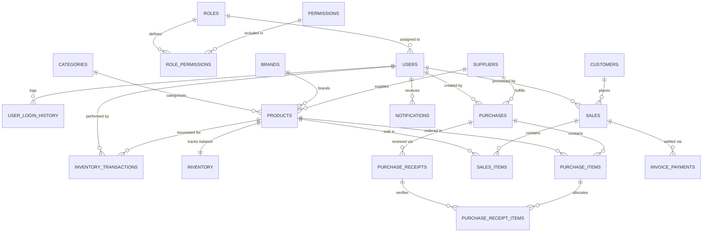
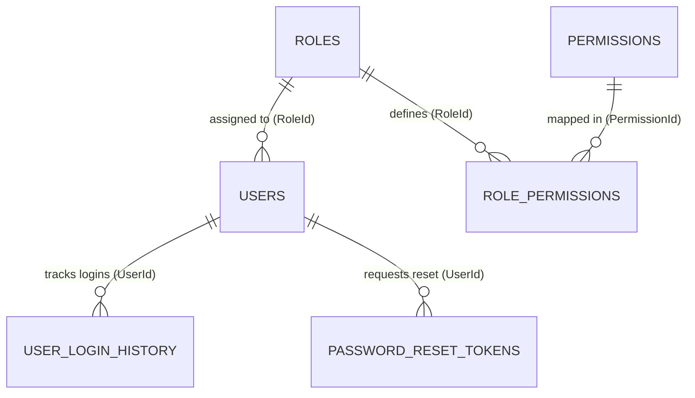

# StockForge --- ASP.NET Web Forms Implementation README

**Project:** StockForge -- Hardware Supply Business Management System\
**Design Source:** Figma --- Hardware Management System\
**Implementation:** ASP.NET Web Forms (.NET Framework) + C#\
**UI Architecture:** ASP.NET Master Page (`Site.Master`) + `.aspx`
Content Pages\
**Purpose:** This README is the developer handoff for reproducing the
StockForge Figma design as a functional .NET Web Forms website.

------------------------------------------------------------------------

## 1. Critical Implementation Rules

These rules are mandatory for the implementation.

1.  **Use ASP.NET Web Forms on .NET Framework.**
2.  Use **C# code-behind** (`.aspx.cs`).
3.  Use an ASP.NET **Master Page** (`Site.Master`) for the common
    application shell.
4.  Do **not** convert the project to ASP.NET Core MVC.
5.  Do **not** use React, Angular, Vue, Blazor, or another frontend
    framework.
6.  Use **HTML + CSS + JavaScript/jQuery + Bootstrap only where it helps
    reproduce the design**.
7.  The Figma design is the visual source of truth. Do not redesign the
    screens.
8.  Preserve the same page hierarchy, navigation pattern, spacing,
    cards, tables, forms, buttons, icons, colors, and responsive
    behavior.
9.  Use **Indian Rupee (₹ / INR)** wherever a monetary amount is
    displayed. Never use `$` or USD.
10. Use reusable CSS classes and Web Forms User Controls instead of
    duplicating the same UI on every page.
11. Do not add unnecessary animations, gradients, glassmorphism, or
    decorative effects that are not present in the design.
12. Keep the interface clean, professional, and business-oriented.

------------------------------------------------------------------------

# 2. Technology Stack

  -----------------------------------------------------------------------
  Layer                               Technology
  ----------------------------------- -----------------------------------
  Framework                           ASP.NET Web Forms

  Runtime                             .NET Framework

  Language                            C#

  Page format                         `.aspx`

  Common layout                       `Site.Master`

  Styling                             CSS3

  Responsive framework                Bootstrap 5 only where useful

  Client-side behavior                JavaScript / jQuery

  Database                            SQL Server / project-approved
                                      database

  Data access                         ADO.NET or the method required by
                                      the course/project

  Icons                               Bootstrap Icons or the icon set
                                      matching the design

  Reports                             ASP.NET-generated report pages /
                                      PDF mechanism used by project

  IDE                                 Visual Studio
  -----------------------------------------------------------------------

------------------------------------------------------------------------

# 3. Recommended Project Structure

Use a structure similar to:

``` text
StockForge/
│
├── Site.Master
├── Site.Master.cs
├── Default.aspx
├── Login.aspx
├── ForgotPassword.aspx
├── ResetPassword.aspx
│
├── Dashboard.aspx
│
├── Products/
│   ├── ProductList.aspx
│   ├── ProductDetails.aspx
│   ├── AddProduct.aspx
│   └── EditProduct.aspx
│
├── Inventory/
│   ├── StockOverview.aspx
│   ├── StockMovementHistory.aspx
│   └── StockAdjustment.aspx
│
├── Suppliers/
│   ├── SupplierList.aspx
│   ├── SupplierDetails.aspx
│   ├── AddSupplier.aspx
│   └── EditSupplier.aspx
│
├── Purchases/
│   ├── PurchaseOrderDetails.aspx
│   ├── EditPurchaseOrder.aspx
│   ├── ReceivePurchase.aspx
│   └── MyPurchase.aspx
│
├── Sales/
│   ├── SalesList.aspx
│   ├── NewSale.aspx
│   ├── SaleDetails.aspx
│   └── EditSale.aspx
│
├── Customers/
│   ├── CustomerList.aspx
│   ├── CustomerDetails.aspx
│   ├── AddCustomer.aspx
│   └── EditCustomer.aspx
│
├── Reports/
│   ├── ReportsDashboard.aspx
│   ├── SalesReport.aspx
│   ├── PurchaseReport.aspx
│   ├── InventoryReport.aspx
│   └── StockValuationReport.aspx
│
├── Users/
│   ├── UserManagement.aspx
│   ├── UserDetails.aspx
│   ├── AddUser.aspx
│   ├── EditUser.aspx
│   └── RolesPermissions.aspx
│
├── Account/
│   └── MyProfile.aspx
│
├── Settings/
│   └── Settings.aspx
│
├── Notifications/
│   └── Notifications.aspx
│
├── Content/
│   ├── site.css
│   ├── responsive.css
│   └── components.css
│
├── Scripts/
│   ├── site.js
│   └── validation.js
│
├── Images/
│   ├── logo/
│   ├── products/
│   └── avatars/
│
├── Controls/
│   ├── Sidebar.ascx
│   ├── Topbar.ascx
│   ├── StatCard.ascx
│   ├── NotificationPanel.ascx
│   └── Pagination.ascx
│
├── App_Code/
├── App_Data/
└── Web.config
```

------------------------------------------------------------------------

# 4. Master Page Requirement

The entire authenticated application should use **`Site.Master`**.

The Master Page is the Web Forms equivalent of the common application
shell. It should contain:

-   Left sidebar
-   Top/header area
-   Application logo/name
-   Notification access
-   User/profile area
-   Main content placeholder
-   Common CSS references
-   Common JavaScript references

Example:

``` aspx
<%@ Master Language="C#" AutoEventWireup="true"
    CodeBehind="Site.Master.cs"
    Inherits="StockForge.SiteMaster" %>

<!DOCTYPE html>
<html>
<head runat="server">
    <title>StockForge</title>

    <link href="Content/site.css" rel="stylesheet" />
    <link href="Content/components.css" rel="stylesheet" />
    <link href="Content/responsive.css" rel="stylesheet" />
</head>

<body>
<form id="form1" runat="server">

    <div class="app-shell">

        <aside class="sidebar">
            <!-- StockForge logo -->
            <!-- Navigation -->
        </aside>

        <div class="main-area">

            <header class="topbar">
                <!-- Page title -->
                <!-- Notifications -->
                <!-- User profile -->
            </header>

            <main class="page-content">
                <asp:ContentPlaceHolder
                    ID="MainContent"
                    runat="server" />
            </main>

        </div>
    </div>

</form>

<script src="Scripts/jquery-3.x.x.min.js"></script>
<script src="Scripts/site.js"></script>
</body>
</html>
```

Every internal page should then use:

``` aspx
<%@ Page Title="Products"
    Language="C#"
    MasterPageFile="~/Site.Master"
    AutoEventWireup="true"
    CodeBehind="ProductList.aspx.cs"
    Inherits="StockForge.Products.ProductList" %>

<asp:Content ID="Content1"
    ContentPlaceHolderID="MainContent"
    runat="server">

    <!-- Page-specific content -->

</asp:Content>
```

------------------------------------------------------------------------

# 5. Visual Design System

## 5.1 Overall Style

The UI should feel:

-   Clean
-   Modern
-   Professional
-   Business-focused
-   Minimal
-   Spacious
-   Easy to scan
-   Consistent across modules

Use the Figma spacing and proportions rather than inventing new layouts.

------------------------------------------------------------------------

# 6. Color System

Use CSS variables so the entire application can be changed from one
location.

``` css
:root {
    --primary: #4CAF7D;
    --primary-dark: #3D946A;
    --primary-light: #EAF7F0;

    --background: #F8FAFC;
    --surface: #FFFFFF;
    --surface-muted: #F5F7F9;

    --text-primary: #1F2937;
    --text-secondary: #6B7280;
    --text-muted: #9CA3AF;

    --border: #E5E7EB;

    --success: #22C55E;
    --warning: #F59E0B;
    --danger: #EF4444;
    --info: #3B82F6;

    --sidebar-width: 250px;
    --topbar-height: 72px;

    --radius-sm: 6px;
    --radius-md: 10px;
    --radius-lg: 14px;

    --shadow-sm: 0 1px 3px rgba(0,0,0,.05);
    --shadow-md: 0 4px 12px rgba(0,0,0,.06);
}
```

If a Figma screen uses a slightly different shade, use the Figma value
for that specific element instead of introducing a random new color.

------------------------------------------------------------------------

# 7. Typography

Use a clean UI font matching the design.

Recommended:

``` css
body {
    font-family: "Inter", "Segoe UI", Arial, sans-serif;
    font-size: 14px;
    color: var(--text-primary);
    background: var(--background);
}
```

Typography hierarchy:

``` css
.page-title {
    font-size: 24px;
    font-weight: 700;
    line-height: 1.25;
}

.section-title {
    font-size: 18px;
    font-weight: 600;
}

.card-title {
    font-size: 15px;
    font-weight: 600;
}

.body-text {
    font-size: 14px;
}

.small-text {
    font-size: 12px;
    color: var(--text-secondary);
}
```

Do not use oversized headings that are not present in the design.

------------------------------------------------------------------------

# 8. Global CSS

Create `Content/site.css`.

``` css
* {
    box-sizing: border-box;
}

html,
body {
    margin: 0;
    padding: 0;
    min-height: 100%;
}

body {
    background: var(--background);
    color: var(--text-primary);
    font-family: "Inter", "Segoe UI", Arial, sans-serif;
    font-size: 14px;
}

a {
    color: inherit;
    text-decoration: none;
}

button,
input,
select,
textarea {
    font: inherit;
}

img {
    max-width: 100%;
    display: block;
}

.app-shell {
    min-height: 100vh;
    display: flex;
}

.main-area {
    flex: 1;
    min-width: 0;
    margin-left: var(--sidebar-width);
}

.page-content {
    padding: 24px;
}

.page-header {
    display: flex;
    justify-content: space-between;
    align-items: center;
    gap: 16px;
    margin-bottom: 24px;
}

.page-title {
    margin: 0;
    font-size: 24px;
    font-weight: 700;
}

.page-subtitle {
    margin-top: 4px;
    color: var(--text-secondary);
}
```

------------------------------------------------------------------------

# 9. Sidebar

The sidebar is a reusable component and belongs in the Master Page.

``` css
.sidebar {
    position: fixed;
    left: 0;
    top: 0;
    bottom: 0;
    width: var(--sidebar-width);
    background: var(--surface);
    border-right: 1px solid var(--border);
    padding: 20px 14px;
    z-index: 1000;
    overflow-y: auto;
}

.sidebar-brand {
    display: flex;
    align-items: center;
    gap: 10px;
    padding: 8px 12px 24px;
}

.sidebar-brand-name {
    font-size: 20px;
    font-weight: 700;
}

.nav-section {
    margin: 20px 10px 8px;
    font-size: 11px;
    font-weight: 600;
    color: var(--text-muted);
    text-transform: uppercase;
}

.nav-item {
    display: flex;
    align-items: center;
    gap: 12px;
    min-height: 44px;
    padding: 10px 12px;
    border-radius: var(--radius-md);
    color: var(--text-secondary);
    transition: background-color .15s ease;
}

.nav-item:hover {
    background: var(--surface-muted);
    color: var(--text-primary);
}

.nav-item.active {
    background: var(--primary-light);
    color: var(--primary);
    font-weight: 600;
}
```

### Sidebar rules

-   Active menu item must clearly show the current page.
-   Use the same icon style throughout.
-   Keep labels consistent.
-   Do not create a different sidebar for each page.
-   Sidebar must work on smaller screens.

------------------------------------------------------------------------

# 10. Topbar

``` css
.topbar {
    height: var(--topbar-height);
    background: var(--surface);
    border-bottom: 1px solid var(--border);
    display: flex;
    align-items: center;
    justify-content: space-between;
    padding: 0 24px;
    position: sticky;
    top: 0;
    z-index: 900;
}

.topbar-actions {
    display: flex;
    align-items: center;
    gap: 10px;
}

.icon-button {
    width: 40px;
    height: 40px;
    border: 0;
    background: transparent;
    border-radius: 50%;
    display: inline-flex;
    align-items: center;
    justify-content: center;
    cursor: pointer;
}

.icon-button:hover {
    background: var(--surface-muted);
}
```

------------------------------------------------------------------------

# 11. Cards

``` css
.card {
    background: var(--surface);
    border: 1px solid var(--border);
    border-radius: var(--radius-lg);
    box-shadow: var(--shadow-sm);
}

.card-header {
    padding: 18px 20px;
    border-bottom: 1px solid var(--border);
}

.card-body {
    padding: 20px;
}

.card-footer {
    padding: 14px 20px;
    border-top: 1px solid var(--border);
}
```

Cards should not have unnecessary gradients or heavy shadows.

------------------------------------------------------------------------

# 12. Dashboard KPI Cards

``` css
.kpi-grid {
    display: grid;
    grid-template-columns: repeat(4, minmax(0, 1fr));
    gap: 16px;
}

.kpi-card {
    padding: 20px;
    background: var(--surface);
    border: 1px solid var(--border);
    border-radius: var(--radius-lg);
}

.kpi-label {
    color: var(--text-secondary);
    font-size: 13px;
}

.kpi-value {
    margin-top: 8px;
    font-size: 26px;
    font-weight: 700;
}

.kpi-change {
    margin-top: 8px;
    font-size: 12px;
}

.kpi-change.positive {
    color: var(--success);
}

.kpi-change.negative {
    color: var(--danger);
}
```

Use ₹ for monetary KPI values:

``` text
₹1,25,000
₹48,500
```

Never:

``` text
$1,250
USD 1,250
```

------------------------------------------------------------------------

# 13. Buttons

``` css
.btn-primary {
    display: inline-flex;
    align-items: center;
    justify-content: center;
    gap: 8px;

    min-height: 40px;
    padding: 9px 16px;

    border: 1px solid var(--primary);
    border-radius: var(--radius-md);

    background: var(--primary);
    color: #fff;

    font-weight: 600;
    cursor: pointer;
}

.btn-primary:hover {
    background: var(--primary-dark);
}

.btn-secondary {
    display: inline-flex;
    align-items: center;
    justify-content: center;
    min-height: 40px;
    padding: 9px 16px;

    border: 1px solid var(--border);
    border-radius: var(--radius-md);

    background: #fff;
    color: var(--text-primary);
}

.btn-danger {
    background: var(--danger);
    color: #fff;
    border: 1px solid var(--danger);
}

.btn-success {
    background: var(--success);
    color: #fff;
    border: 1px solid var(--success);
}
```

Buttons should have consistent height, padding, radius, and typography.

------------------------------------------------------------------------

# 14. Forms

``` css
.form-group {
    margin-bottom: 18px;
}

.form-label {
    display: block;
    margin-bottom: 7px;
    font-weight: 600;
    color: var(--text-primary);
}

.form-control,
.form-select {
    width: 100%;
    min-height: 42px;
    padding: 9px 12px;

    border: 1px solid var(--border);
    border-radius: var(--radius-md);

    background: #fff;
    color: var(--text-primary);

    outline: none;
}

.form-control:focus,
.form-select:focus {
    border-color: var(--primary);
    box-shadow: 0 0 0 3px rgba(76,175,125,.12);
}

textarea.form-control {
    min-height: 100px;
    resize: vertical;
}
```

Required field:

``` html
<span class="required">*</span>
```

``` css
.required {
    color: var(--danger);
}
```

------------------------------------------------------------------------

# 15. Tables

Use tables for products, suppliers, customers, sales, purchases, and
users.

``` css
.data-table {
    width: 100%;
    border-collapse: collapse;
    background: #fff;
}

.data-table th {
    padding: 13px 16px;
    text-align: left;
    background: var(--surface-muted);
    color: var(--text-secondary);
    font-size: 12px;
    font-weight: 600;
    border-bottom: 1px solid var(--border);
}

.data-table td {
    padding: 14px 16px;
    border-bottom: 1px solid var(--border);
    vertical-align: middle;
}

.data-table tbody tr:hover {
    background: #FAFCFB;
}
```

Keep action buttons compact.

------------------------------------------------------------------------

# 16. Status Badges

``` css
.badge {
    display: inline-flex;
    align-items: center;
    padding: 5px 9px;
    border-radius: 999px;
    font-size: 11px;
    font-weight: 600;
}

.badge-success {
    background: #EAF8EF;
    color: #15803D;
}

.badge-warning {
    background: #FFF7E6;
    color: #B45309;
}

.badge-danger {
    background: #FEECEC;
    color: #B91C1C;
}

.badge-info {
    background: #EAF2FF;
    color: #1D4ED8;
}

.badge-neutral {
    background: #F3F4F6;
    color: #4B5563;
}
```

Examples:

-   Paid → success
-   Unpaid → warning
-   Cancelled → danger
-   Active → success
-   Inactive → neutral
-   Low Stock → warning/danger depending on the Figma state

------------------------------------------------------------------------

# 17. Search and Filters

``` css
.filter-bar {
    display: flex;
    align-items: center;
    gap: 12px;
    flex-wrap: wrap;
    margin-bottom: 18px;
}

.search-box {
    position: relative;
    flex: 1;
    min-width: 220px;
}

.search-box input {
    width: 100%;
    min-height: 42px;
    padding: 9px 12px 9px 38px;
    border: 1px solid var(--border);
    border-radius: var(--radius-md);
}
```

Filters should not move the main content unexpectedly.

------------------------------------------------------------------------

# 18. Empty States

Use an empty state when there is no data.

``` css
.empty-state {
    padding: 48px 20px;
    text-align: center;
    color: var(--text-secondary);
}

.empty-state-title {
    margin-top: 12px;
    font-size: 16px;
    font-weight: 600;
    color: var(--text-primary);
}

.empty-state-text {
    margin-top: 6px;
    font-size: 13px;
}
```

------------------------------------------------------------------------

# 19. Modals

``` css
.modal-content {
    border: 0;
    border-radius: var(--radius-lg);
    box-shadow: 0 15px 40px rgba(0,0,0,.15);
}

.modal-header {
    padding: 18px 20px;
    border-bottom: 1px solid var(--border);
}

.modal-body {
    padding: 20px;
}

.modal-footer {
    padding: 14px 20px;
    border-top: 1px solid var(--border);
}
```

Use modals only where the design uses a modal. Do not replace full pages
with modals without a design reason.

------------------------------------------------------------------------

# 20. Responsive Design

Create `Content/responsive.css`.

``` css
@media (max-width: 1200px) {
    .kpi-grid {
        grid-template-columns: repeat(2, minmax(0, 1fr));
    }
}

@media (max-width: 992px) {
    :root {
        --sidebar-width: 0px;
    }

    .sidebar {
        transform: translateX(-100%);
        transition: transform .2s ease;
    }

    .sidebar.open {
        transform: translateX(0);
        width: 250px;
    }

    .main-area {
        margin-left: 0;
    }
}

@media (max-width: 768px) {
    .page-content {
        padding: 16px;
    }

    .page-header {
        align-items: flex-start;
        flex-direction: column;
    }

    .kpi-grid {
        grid-template-columns: 1fr;
    }

    .filter-bar {
        flex-direction: column;
        align-items: stretch;
    }

    .search-box {
        width: 100%;
    }

    .table-wrapper {
        overflow-x: auto;
    }

    .data-table {
        min-width: 760px;
    }
}
```

The desktop design must remain the primary visual reference. Responsive
behavior should preserve usability without changing the visual identity.

------------------------------------------------------------------------

# 21. JavaScript

Create `Scripts/site.js`.

Use JavaScript/jQuery for:

-   Sidebar toggle
-   Dropdowns
-   Modal interaction
-   Search/filter UI
-   Password visibility
-   Client-side validation where required
-   Notification panel
-   Table interactions
-   Confirmation dialogs

Do not put large JavaScript blocks directly into every `.aspx` file.

Example:

``` javascript
$(function () {

    $(".sidebar-toggle").on("click", function () {
        $(".sidebar").toggleClass("open");
    });

    $(".password-toggle").on("click", function () {
        const input = $(this)
            .closest(".password-wrapper")
            .find("input");

        input.attr(
            "type",
            input.attr("type") === "password" ? "text" : "password"
        );
    });

});
```

------------------------------------------------------------------------

# 22. Web Forms Controls

Prefer ASP.NET controls where server-side functionality is required.

Example:

``` aspx
<asp:TextBox
    ID="txtProductName"
    runat="server"
    CssClass="form-control" />

<asp:DropDownList
    ID="ddlCategory"
    runat="server"
    CssClass="form-select" />

<asp:Button
    ID="btnSave"
    runat="server"
    Text="Save Product"
    CssClass="btn-primary"
    OnClick="btnSave_Click" />
```

Do not allow default Web Forms styling to override the Figma styling.

------------------------------------------------------------------------

# 23. GridView Styling

If `GridView` is used:

``` aspx
<asp:GridView
    ID="gvProducts"
    runat="server"
    CssClass="data-table"
    AutoGenerateColumns="False">
</asp:GridView>
```

Use CSS to make the generated table match the Figma design.

Avoid default GridView borders, blue links, or browser-style controls.

------------------------------------------------------------------------

# 24. Authentication Screens

The authentication flow includes:

1.  Landing Page
2.  Login
3.  Forgot Password
4.  Reset Password

Authentication pages should use a simpler layout than the authenticated
dashboard if the Figma design shows a separate authentication shell.

### Login requirements

-   Email/username field
-   Password field
-   Show/hide password
-   Login button
-   Forgot Password link
-   Validation message
-   Figma-matching branding

Do not show the dashboard sidebar on the login screen unless the Figma
explicitly does so.

------------------------------------------------------------------------

# 25. Dashboard

The dashboard is the primary authenticated landing page.

It should contain the elements shown in the design, such as:

-   KPI/stat cards
-   Sales overview
-   Inventory information
-   Low-stock information
-   Recent activity
-   Quick actions
-   Relevant business summaries

All dashboard values should come from the database once backend
integration is implemented.

------------------------------------------------------------------------

# 26. Product Management

Pages:

-   Product List
-   Product Details
-   Add Product
-   Edit Product

Product data should support the fields represented in the design.

Typical fields:

-   Product name
-   Category
-   SKU/product code if present
-   Unit
-   Purchase price
-   Selling price
-   Minimum stock level
-   Current stock
-   Batch number where required
-   Expiry date where required
-   Status
-   Product image where required

Money must use ₹ / INR.

------------------------------------------------------------------------

# 27. Inventory

Pages:

-   Stock Overview
-   Stock Movement History
-   Stock Adjustment
-   Inventory Report
-   Stock Valuation Report

Inventory should show:

-   Current stock
-   Low-stock state
-   Stock movement
-   Adjustment records
-   Stock valuation
-   Relevant product information

Do not create a warehouse-management UI that is not present in the
design.

------------------------------------------------------------------------

# 28. Supplier Management

Pages:

-   Supplier List with KPIs
-   Supplier Details
-   Add Supplier
-   Edit Supplier

Supplier information should include only fields required by the
design/business requirements.

Supplier-related monetary values must use INR.

------------------------------------------------------------------------

# 29. Purchase Management

Pages:

-   Purchase Order Details
-   Edit Purchase Order
-   Receive Purchase
-   My Purchase
-   Purchase Report
-   Responsive Purchase Order System

Important behaviors:

-   Purchase Order Number should be generated automatically.
-   Purchase receipt should update inventory.
-   Purchase return behavior should be supported if present in the
    project requirements.
-   Do not invent unnecessary delivery/notification screens.

------------------------------------------------------------------------

# 30. Sales Management

Pages:

-   Sales List
-   New Sale
-   Sale Details
-   Edit Sale
-   Sales Report
-   Responsive Invoice System

Important behavior:

1.  User selects customer.
2.  User selects products.
3.  Quantity is entered.
4.  Total is calculated.
5.  Sale is saved.
6.  Inventory is updated.
7.  Invoice is generated according to the project flow.

Use Indian numbering/currency presentation where applicable.

Example:

``` text
Subtotal      ₹10,000
Tax           ₹1,800
Grand Total   ₹11,800
```

------------------------------------------------------------------------

# 31. Customer Management

Pages:

-   Customer List
-   Customer Details
-   Add Customer
-   Edit Customer

Use consistent table, form, badge, and action styles.

Optional GST information should be displayed only where required by the
project/design.

------------------------------------------------------------------------

# 32. Reports

Pages:

-   Reports Dashboard
-   Sales Report
-   Purchase Report
-   Inventory Report
-   Stock Valuation Report

Reports should prioritize:

-   Clear filters
-   Date range
-   Summary information
-   Tables
-   Totals
-   Print/export action if represented in the design

Do not introduce Excel export if it is not part of the approved project
requirements.

------------------------------------------------------------------------

# 33. User Management

Pages:

-   User Management
-   User Details
-   Add User
-   Edit User
-   Roles & Permissions

Admin functionality should support:

-   Add user
-   Edit user
-   Activate/deactivate user
-   Delete user where permitted
-   Assign role
-   Manage permissions

Permissions should be enforced in C# server-side code, not only hidden
through CSS/JavaScript.

------------------------------------------------------------------------

# 34. Profile, Settings & Notifications

Pages:

-   My Profile
-   Settings
-   Notifications
-   Actions & Profile

Keep these pages visually consistent with the main application shell.

Notifications should use the same badge/icon language as the Figma
design.

------------------------------------------------------------------------

# 35. Reusable Components

Create reusable Web Forms User Controls (`.ascx`) for repeated UI.

Recommended:

``` text
Controls/
├── Sidebar.ascx
├── Topbar.ascx
├── StatCard.ascx
├── NotificationPanel.ascx
├── UserMenu.ascx
├── StatusBadge.ascx
└── Pagination.ascx
```

Example:

``` aspx
<uc1:Sidebar runat="server" ID="Sidebar1" />
```

This prevents duplicate HTML and keeps the design consistent.

------------------------------------------------------------------------

# 36. Page Naming

Use clear page names.

Recommended:

``` text
ProductList.aspx
ProductDetails.aspx
AddProduct.aspx
EditProduct.aspx

SupplierList.aspx
SupplierDetails.aspx
AddSupplier.aspx
EditSupplier.aspx

CustomerList.aspx
CustomerDetails.aspx
AddCustomer.aspx
EditCustomer.aspx
```

Do not use names such as:

``` text
page1.aspx
newpage.aspx
test2.aspx
finalpage.aspx
```

------------------------------------------------------------------------

# 37. Database/UI Separation

The UI should not contain SQL queries directly.

Bad:

``` csharp
protected void Page_Load(...)
{
    // SQL query + UI + business logic all mixed here
}
```

Prefer a structure such as:

``` text
.aspx
    ↓
.aspx.cs
    ↓
Business/Data Layer
    ↓
Database
```

The exact data-access architecture can follow the course/project
requirements, but keep the presentation layer clean.

------------------------------------------------------------------------

# 38. Validation

Use proper validation for:

-   Required fields
-   Email format
-   Numeric values
-   Positive quantity
-   Price
-   Date
-   Password rules
-   Duplicate records

Use ASP.NET validators where appropriate:

``` aspx
<asp:RequiredFieldValidator
    ID="rfvProductName"
    runat="server"
    ControlToValidate="txtProductName"
    ErrorMessage="Product name is required."
    CssClass="validation-error" />
```

CSS:

``` css
.validation-error {
    display: block;
    margin-top: 5px;
    color: var(--danger);
    font-size: 12px;
}
```

Client-side validation improves UX, but important validation must also
be performed server-side.

------------------------------------------------------------------------

# 39. Accessibility

Follow these rules:

-   Use real labels for form controls.
-   Maintain visible focus states.
-   Do not rely only on color to indicate status.
-   Use descriptive `alt` text for meaningful images.
-   Decorative images should have empty alt text.
-   Use semantic headings.
-   Ensure buttons have clear labels.
-   Maintain sufficient contrast.
-   Ensure keyboard users can access navigation and controls.

Example:

``` html

```

------------------------------------------------------------------------

# 40. Image Rules

Use:

``` css
.product-image {
    width: 48px;
    height: 48px;
    object-fit: cover;
    border-radius: 8px;
}
```

Do not stretch images.

For large screenshots/design references, preserve their aspect ratio.

------------------------------------------------------------------------

# 41. Icons

Use one icon family consistently.

Recommended:

-   Bootstrap Icons
-   Or the exact icon family represented in the Figma design

Examples:

``` html
<i class="bi bi-grid"></i>
<i class="bi bi-box-seam"></i>
<i class="bi bi-people"></i>
<i class="bi bi-cart"></i>
<i class="bi bi-bar-chart"></i>
```

Do not mix random Font Awesome, Material Icons, Unicode symbols, and SVG
icons unless required.

------------------------------------------------------------------------

# 42. Spacing System

Use a consistent spacing scale:

``` css
:root {
    --space-1: 4px;
    --space-2: 8px;
    --space-3: 12px;
    --space-4: 16px;
    --space-5: 20px;
    --space-6: 24px;
    --space-8: 32px;
    --space-10: 40px;
}
```

Prefer these values over arbitrary values.

Typical usage:

-   Page padding: 24px
-   Card padding: 20px
-   Form field gap: 18px
-   Table cell padding: 14--16px
-   Button horizontal padding: 16px

Adjust when the Figma measurement clearly differs.

------------------------------------------------------------------------

# 43. Border Radius

Use the following baseline:

``` css
--radius-sm: 6px;
--radius-md: 10px;
--radius-lg: 14px;
```

Do not make every element extremely rounded.

Pills are reserved for statuses/tags where appropriate.

------------------------------------------------------------------------

# 44. Shadows

Keep shadows subtle:

``` css
box-shadow: 0 1px 3px rgba(0,0,0,.05);
```

For dialogs:

``` css
box-shadow: 0 15px 40px rgba(0,0,0,.15);
```

Do not use heavy neon or floating shadows.

------------------------------------------------------------------------

# 45. Responsive Behavior

Desktop:

``` text
Sidebar + Topbar + Main Content
```

Tablet:

``` text
Collapsible Sidebar + Topbar + Main Content
```

Mobile:

``` text
Hidden/Drawer Sidebar
Full-width Content
Stacked Cards
Horizontal Table Scrolling
```

Tables may scroll horizontally on small screens instead of becoming
unreadably narrow.

------------------------------------------------------------------------

# 46. Design Matching Checklist

Every implemented page must be checked against the Figma screen for:

### Layout

-   [ ] Same overall structure
-   [ ] Same sidebar position
-   [ ] Same header position
-   [ ] Same content width
-   [ ] Same major sections

### Typography

-   [ ] Same hierarchy
-   [ ] Similar font weights
-   [ ] Similar text sizes
-   [ ] Same capitalization style

### Colors

-   [ ] Same background
-   [ ] Same primary green
-   [ ] Same text colors
-   [ ] Same status colors

### Components

-   [ ] Buttons match
-   [ ] Cards match
-   [ ] Tables match
-   [ ] Inputs match
-   [ ] Badges match
-   [ ] Icons match

### Spacing

-   [ ] Page padding matches
-   [ ] Card spacing matches
-   [ ] Section spacing matches
-   [ ] Form spacing matches

### Behavior

-   [ ] Navigation works
-   [ ] Buttons work
-   [ ] Forms validate
-   [ ] Data loads correctly
-   [ ] CRUD actions work
-   [ ] Responsive layout works

------------------------------------------------------------------------

# 47. Complete Design Screen Reference

The supplied StockForge design package contains these
screens/components. Implement them in the same functional grouping and
visual order used by the design.

## Authentication / Entry

1.  StockForge Landing Page
2.  StockForge Login
3.  StockForge Forgot Password
4.  StockForge Reset Password

## Dashboard / Application Shell

5.  StockForge Admin Dashboard (Optimized)
6.  SideNavBar
7.  SideNavBar-1
8.  Main Content Area
9.  Actions & Profile
10. StockForge Notifications

## Product Management

11. StockForge Product List
12. StockForge Product Details
13. StockForge Add Product
14. StockForge Edit Product (Balanced Full Screen)

## Inventory

15. StockForge Stock Overview
16. StockForge Stock Movement History
17. StockForge Stock Adjustment

## Purchase Management

18. StockForge Purchase Order Details
19. StockForge Edit Purchase Order
20. StockForge Receive Purchase
21. My Purchase
22. StockForge Responsive Purchase Order System
23. Container

## Supplier Management

24. StockForge Supplier List with KPIs
25. StockForge Supplier Details
26. StockForge Add Supplier
27. StockForge Edit Supplier

## Sales Management

28. StockForge Sales List
29. StockForge New Sale
30. StockForge Sale Details
31. StockForge Edit Sale
32. StockForge Responsive Invoice System

## Customer Management

33. StockForge Customer List
34. StockForge Customer Details
35. StockForge Add Customer
36. StockForge Edit Customer

## Reports

37. StockForge Reports Dashboard
38. StockForge Sales Report
39. StockForge Purchase Report
40. StockForge Inventory Report
41. StockForge Stock Valuation Report

## User Management

42. StockForge User Management
43. StockForge User Details
44. StockForge Add User
45. StockForge Edit User (No-Scroll)
46. StockForge Roles & Permissions

## Account / Settings

47. StockForge My Profile
48. StockForge Settings

------------------------------------------------------------------------

# 48. Implementation Order

Do not implement all pages randomly.

Recommended order:

### Phase 1 --- Foundation

1.  Create ASP.NET Web Forms project.
2.  Create `Site.Master`.
3.  Add global CSS.
4.  Add sidebar.
5.  Add topbar.
6.  Add responsive behavior.
7.  Add common buttons/cards/forms/tables.

### Phase 2 --- Authentication

8.  Landing Page
9.  Login
10. Forgot Password
11. Reset Password

### Phase 3 --- Dashboard

12. Admin Dashboard

### Phase 4 --- Core CRUD

13. Products
14. Suppliers
15. Customers

### Phase 5 --- Transactions

16. Purchases
17. Sales
18. Invoices

### Phase 6 --- Inventory

19. Stock Overview
20. Stock Movement
21. Stock Adjustment

### Phase 7 --- Reports

22. Reports Dashboard
23. Sales Report
24. Purchase Report
25. Inventory Report
26. Stock Valuation Report

### Phase 8 --- Administration

27. User Management
28. User Details
29. Add/Edit User
30. Roles & Permissions

### Phase 9 --- Supporting Screens

31. My Profile
32. Settings
33. Notifications

------------------------------------------------------------------------

# 49. Final Instruction for Implementation Agent

**Implement StockForge as an ASP.NET Web Forms application on .NET
Framework using C# and an ASP.NET Master Page.**

The Figma design is the visual source of truth. Reproduce the design
rather than creating a new UI.

Use:

``` text
ASP.NET Web Forms
C#
Site.Master
.aspx pages
CSS3
JavaScript/jQuery
Bootstrap only where useful
```

The common authenticated interface must be built through `Site.Master`.

Create reusable CSS classes and reusable `.ascx` controls for repeated
components.

The implementation must be responsive, accessible, and functional.

All monetary values must use **Indian Rupee (₹ / INR)**.

Do not use:

``` text
ASP.NET Core
MVC
Blazor
React
Angular
Vue
Dollar ($)
Unnecessary animations
Gradients not present in the design
Glassmorphism
Unrelated UI redesigns
```

Before considering a page complete, compare its implementation against
the corresponding Figma screen and correct:

-   spacing
-   dimensions
-   typography
-   colors
-   borders
-   radius
-   shadows
-   icons
-   alignment
-   component states
-   responsive behavior

**Priority order:**

``` text
1. Match Figma layout
2. Match Figma styling
3. Make components reusable
4. Connect backend/database
5. Add validation
6. Test all interactions
7. Test responsive behavior
```

The final result should look like the same StockForge product shown in
Figma, but implemented as a working ASP.NET Web Forms application.

## Database Architecture & Complete Page-to-Table Reference

StockForge utilizes Microsoft SQL Server / LocalDB (`(localdb)\MSSQLLocalDB`) configured via the `StockForgeDb` connection string in `Web.config`. All pages are powered by server-side C# code-behind controllers (`.aspx.cs`) and ADO.NET / Generic Repository patterns (`DataAccess/GenericRepository.cs`). All validations are performed exclusively on the server (`EnableClientScript="false"`), without client-side JavaScript dependencies.

For the standalone database design manual and complete SQL install scripts, refer to [DATABASE_SCHEMA.md](file:///d:/.net%20Project/Stock_Forgeeee/DATABASE_SCHEMA.md) and [Database/StockForge_Schema.sql](file:///d:/.net%20Project/Stock_Forgeeee/Database/StockForge_Schema.sql).

---

### Page-to-Table & Database Entity Mapping

| Page Route | Screen Title & Purpose | Primary Database Table | Related / Foreign Key Tables |
| :--- | :--- | :--- | :--- |
| **`Dashboard.aspx`** | Executive Overview & KPI Metrics | Aggregated Views | `dbo.Sales`, `dbo.Purchases`, `dbo.Products`, `dbo.Inventory`, `dbo.Notifications` |
| **`Account/Login.aspx`** | User Sign In & Session Creation | `dbo.Users` | `dbo.Roles`, `dbo.UserLoginHistory` |
| **`Account/Register.aspx`** | Self-Service Registration | `dbo.Users` | `dbo.Roles`, `dbo.Settings` |
| **`Account/ForgotPassword.aspx`** | Password Recovery Request | `dbo.Users` | `dbo.PasswordResetTokens` |
| **`Account/ResetPassword.aspx`** | Password Reset Execution | `dbo.Users` | `dbo.PasswordResetTokens` |
| **`Account/MyProfile.aspx`** | User Profile & Security Settings | `dbo.Users` | `dbo.Roles` |
| **`Users/UserManagement.aspx`** | User Master List & Role Cards | `dbo.Users` | `dbo.Roles` |
| **`Users/AddUser.aspx`** | Create New Team Member | `dbo.Users` | `dbo.Roles` |
| **`Users/UserDetails.aspx`** | User Profile & Activity Log | `dbo.Users` | `dbo.Roles`, `dbo.UserLoginHistory` |
| **`Users/EditUser.aspx`** | Edit User Profile & Status | `dbo.Users` | `dbo.Roles` |
| **`Users/RolesPermissions.aspx`** | Role Access Control Matrix | `dbo.RolePermissions` | `dbo.Roles`, `dbo.Permissions` |
| **`Products/ProductList.aspx`** | Inventory Master Catalog | `dbo.Products` | `dbo.Categories`, `dbo.Brands`, `dbo.Inventory` |
| **`Products/AddProduct.aspx`** | Add New Catalog Item | `dbo.Products` | `dbo.Categories`, `dbo.Brands`, `dbo.Inventory`, `dbo.Suppliers` |
| **`Products/ProductDetails.aspx`** | Single Product View & Movements | `dbo.Products` | `dbo.Categories`, `dbo.Brands`, `dbo.Inventory`, `dbo.InventoryTransactions` |
| **`Products/EditProduct.aspx`** | Edit Product Specs & Pricing | `dbo.Products` | `dbo.Categories`, `dbo.Brands`, `dbo.Inventory`, `dbo.Suppliers` |
| **`Suppliers/SupplierList.aspx`** | Vendor Directory & KPIs | `dbo.Suppliers` | `dbo.Purchases` |
| **`Suppliers/AddSupplier.aspx`** | Onboard New Supplier | `dbo.Suppliers` | - |
| **`Suppliers/SupplierDetails.aspx`** | Vendor Ledger & Order History | `dbo.Suppliers` | `dbo.Purchases`, `dbo.PurchaseItems` |
| **`Suppliers/EditSupplier.aspx`** | Update Vendor Profile & GSTIN | `dbo.Suppliers` | - |
| **`Customers/CustomerList.aspx`** | Customer CRM Directory | `dbo.Customers` | `dbo.Sales` |
| **`Customers/AddCustomer.aspx`** | Register New Customer | `dbo.Customers` | - |
| **`Customers/CustomerDetails.aspx`** | Customer Ledger & Past Orders | `dbo.Customers` | `dbo.Sales`, `dbo.SalesItems` |
| **`Customers/EditCustomer.aspx`** | Update Customer & GST Profile | `dbo.Customers` | - |
| **`Purchases/MyPurchase.aspx`** | Purchase Orders Directory | `dbo.Purchases` | `dbo.Suppliers`, `dbo.PurchaseItems` |
| **`Purchases/PurchaseOrderDetails.aspx`** | PO Details & Line Items | `dbo.Purchases` | `dbo.Suppliers`, `dbo.PurchaseItems`, `dbo.Products` |
| **`Purchases/EditPurchaseOrder.aspx`** | Modify PO & Quantities | `dbo.Purchases` | `dbo.PurchaseItems`, `dbo.Suppliers`, `dbo.Products` |
| **`Purchases/ReceivePurchase.aspx`** | Goods Receipt & Quality Check | `dbo.PurchaseReceipts` | `dbo.Purchases`, `dbo.PurchaseReceiptItems`, `dbo.Inventory` |
| **`Purchases/PrintPurchaseOrder.aspx`** | PO Print & PDF Layout | `dbo.Purchases` | `dbo.Suppliers`, `dbo.PurchaseItems`, `dbo.Products`, `dbo.Settings` |
| **`Sales/SalesList.aspx`** | Sales Orders Directory | `dbo.Sales` | `dbo.Customers`, `dbo.SalesItems` |
| **`Sales/NewSale.aspx`** | POS Direct Sale Entry | `dbo.Sales` | `dbo.SalesItems`, `dbo.Customers`, `dbo.Products`, `dbo.Inventory` |
| **`Sales/SaleDetails.aspx`** | Sale Details & Summary | `dbo.Sales` | `dbo.Customers`, `dbo.SalesItems`, `dbo.Products`, `dbo.InvoicePayments` |
| **`Sales/EditSale.aspx`** | Edit Draft Sale & Line Items | `dbo.Sales` | `dbo.SalesItems`, `dbo.Customers`, `dbo.Products`, `dbo.Inventory` |
| **`Sales/Invoice.aspx`** | GST Tax Invoice Document | `dbo.Sales` | `dbo.SalesItems`, `dbo.Customers`, `dbo.InvoicePayments`, `dbo.Settings` |
| **`Inventory/StockOverview.aspx`** | Real-time Warehouse Balance | `dbo.Inventory` | `dbo.Products`, `dbo.Categories` |
| **`Inventory/StockAdjustment.aspx`** | Manual Stock Reconcile | `dbo.InventoryTransactions` | `dbo.Products`, `dbo.Inventory`, `dbo.Users` |
| **`Inventory/StockMovementHistory.aspx`** | Movement Audit Trail | `dbo.InventoryTransactions` | `dbo.Products`, `dbo.Users` |
| **`Reports/ReportsDashboard.aspx`** | Financial & Sales Overview | Aggregated Views | `dbo.Sales`, `dbo.Purchases`, `dbo.Products`, `dbo.Inventory` |
| **`Reports/SalesReport.aspx`** | Sales Performance Analytics | `dbo.Sales` | `dbo.SalesItems`, `dbo.Customers`, `dbo.Products` |
| **`Reports/PurchaseReport.aspx`** | Procurement Spending Report | `dbo.Purchases` | `dbo.PurchaseItems`, `dbo.Suppliers` |
| **`Reports/InventoryReport.aspx`** | Stock Valuation & Turnover | `dbo.Products` | `dbo.Inventory`, `dbo.Categories` |
| **`Reports/StockValuationReport.aspx`** | Asset & Retail Valuation | `dbo.Products` | `dbo.Inventory`, `dbo.Categories` |
| **`Settings/Settings.aspx`** | Business & Store Settings | `dbo.Settings` | - |
| **`Notifications/Notifications.aspx`** | Alert Feed & Actions | `dbo.Notifications` | `dbo.Users` |
| **`Landing.aspx` / `Help.aspx`** | Public Support & Contact | `dbo.ContactInquiries` | - |

---

### Entity-Relationship Diagram



---

### Detailed Database Tables, Columns, Datatypes & Keys

---

### Module 1: Authentication, Registration & User Security Subsystem

This module powers all user onboarding, sign-in, session auditing, role-based authorization, and self-service password recovery across the application:
- **Sign In / Login:** [Account/Login.aspx](file:///d:/.net%20Project/Stock_Forgeeee/Account/Login.aspx) & [Login.aspx.cs](file:///d:/.net%20Project/Stock_Forgeeee/Account/Login.aspx.cs)
- **Store Registration:** [Account/Register.aspx](file:///d:/.net%20Project/Stock_Forgeeee/Account/Register.aspx) & [Register.aspx.cs](file:///d:/.net%20Project/Stock_Forgeeee/Account/Register.aspx.cs)
- **Personal Profile:** [Account/MyProfile.aspx](file:///d:/.net%20Project/Stock_Forgeeee/Account/MyProfile.aspx) & [MyProfile.aspx.cs](file:///d:/.net%20Project/Stock_Forgeeee/Account/MyProfile.aspx.cs)
- **Forgot Password Request:** [Account/ForgotPassword.aspx](file:///d:/.net%20Project/Stock_Forgeeee/Account/ForgotPassword.aspx) & [ForgotPassword.aspx.cs](file:///d:/.net%20Project/Stock_Forgeeee/Account/ForgotPassword.aspx.cs)
- **Create New Password:** [Account/ResetPassword.aspx](file:///d:/.net%20Project/Stock_Forgeeee/Account/ResetPassword.aspx) & [ResetPassword.aspx.cs](file:///d:/.net%20Project/Stock_Forgeeee/Account/ResetPassword.aspx.cs)
- **User Management & Audit:** [Users/UserManagement.aspx](file:///d:/.net%20Project/Stock_Forgeeee/Users/UserManagement.aspx) & [Users/UserDetails.aspx](file:///d:/.net%20Project/Stock_Forgeeee/Users/UserDetails.aspx)
- **Role Permission Matrix:** [Users/RolesPermissions.aspx](file:///d:/.net%20Project/Stock_Forgeeee/Users/RolesPermissions.aspx)

#### Authentication Entity Relationship (ER) Model



---

#### 1. Users Table (`dbo.Users`)
- **Primary Pages:** `Account/Login.aspx`, `Account/Register.aspx`, `Account/MyProfile.aspx`, `Account/ForgotPassword.aspx`, `Account/ResetPassword.aspx`, `Users/UserManagement.aspx`, `Users/AddUser.aspx`, `Users/EditUser.aspx`, `Users/UserDetails.aspx`
- **Purpose:** Core identity repository storing user credentials, store profile, contact info, security flags, and timestamps.

| Column Name | Data Type | Nullable | Key / Constraint | Target Reference | UI Control / Page Mapping | Description & Validation Rules |
| :--- | :--- | :--- | :--- | :--- | :--- | :--- |
| `UserId` | `INT` | NO | **PK**, `IDENTITY(1,1)` | - | System Unique ID | Primary key for user accounts |
| `StoreName` | `NVARCHAR(150)` | YES | - | - | `txtStoreName` (Register) | Store / business trade name ("Apex Tools"). Required on registration. |
| `StoreCategory` | `NVARCHAR(100)` | YES | - | - | `ddlStoreCategory` (Register) | Dropdown category: "General Hardware", "Electrical", "Plumbing", "Power Tools" |
| `FullName` | `NVARCHAR(100)` | NO | - | - | `txtFullName` (Register, Profile, Users) | User full name ("Khush Dobariya"). Validated server-side. |
| `Email` | `NVARCHAR(100)` | NO | **UQ**, **INDEX** | - | `txtEmail` (Login, Register, Forgot, Profile) | Unique user login email. RFC compliant regex validation on server. |
| `PasswordHash` | `NVARCHAR(255)` | NO | - | - | `txtPassword` (Login, Register), `txtNewPassword` (Reset) | Salted password hash (never stored plain text). Minimum 6-8 chars. |
| `RoleId` | `INT` | NO | **FK**, **INDEX** | `dbo.Roles(RoleId)` | `ddlRole` (Users), Badges in Profile & Topbar | User permission role (1 = System Admin, 2 = Store Manager, 3 = Staff) |
| `Phone` | `NVARCHAR(25)` | YES | - | - | `txtPhone` (Profile, Add User) | Contact phone number ("+91 98765 43210"). Validated via regex. |
| `ProfilePic` | `NVARCHAR(255)` | YES | - | - | User avatar container (Profile, Topbar) | Image path or initial avatar generator ("KD") |
| `Timezone` | `NVARCHAR(50)` | YES | `DEFAULT ('Asia/Kolkata')` | - | Timezone dropdown (Profile) | User display timezone ("Asia/Kolkata (IST)") |
| `Notes` | `NVARCHAR(500)` | YES | - | - | `txtNotes` (User Management) | Administrative notes |
| `IsActive` | `BIT` | NO | `DEFAULT (1)` | - | Status pill badge (Profile, User List) | Active (`1`) or Inactive (`0`) toggle |
| `RememberMeToken` | `NVARCHAR(255)` | YES | - | - | `chkRemember` (Login) | Secure persistent authentication cookie token |
| `PasswordChangedAt`|`DATETIME2` | YES | - | - | "Last changed 30 days ago" label (Profile) | Date and time when the password was last modified |
| `LastLoginAt` | `DATETIME2` | YES | - | - | "Last Active Today, 10:42 AM" (Profile) | Timestamp of the most recent successful sign-in |
| `CreatedAt` | `DATETIME2` | NO | `DEFAULT (GETDATE())` | - | "Member Since 01 Aug 2026" (Profile) | Account creation timestamp |
| `UpdatedAt` | `DATETIME2` | YES | - | - | `btnSaveProfile_Click` (Profile) | Profile modification timestamp |

---

#### 2. User Login History Table (`dbo.UserLoginHistory`)
- **Primary Pages:** `Account/Login.aspx`, `Users/UserDetails.aspx`
- **Purpose:** Security audit log tracking client IP addresses, timestamps, session lifetimes, and authentication outcomes.

| Column Name | Data Type | Nullable | Key / Constraint | Target Reference | UI Control / Page Mapping | Description & Validation Rules |
| :--- | :--- | :--- | :--- | :--- | :--- | :--- |
| `LoginHistoryId` | `INT` | NO | **PK**, `IDENTITY(1,1)` | - | Unique login log ID | Primary key for login attempt record |
| `UserId` | `INT` | YES | **FK**, **INDEX** | `dbo.Users(UserId)` | User session link | Target user ID (or NULL if non-existent user attempted login) |
| `Email` | `NVARCHAR(100)` | NO | - | - | `txtEmail` (Login) | Email string supplied during authentication attempt |
| `LoginAt` | `DATETIME2` | NO | `DEFAULT (GETDATE())` | - | Activity History timestamp | Exact time when authentication attempt occurred |
| `LogoutAt` | `DATETIME2` | YES | - | - | Topbar "Log Out" action | Timestamp when session was terminated |
| `IpAddress` | `NVARCHAR(50)` | YES | - | - | Activity Log IP column | Client IPv4 / IPv6 network address |
| `UserAgent` | `NVARCHAR(255)` | YES | - | - | Browser / device detection | Browser name, version, and OS platform |
| `Status` | `NVARCHAR(30)` | NO | `DEFAULT ('Success')` | - | Status badge ('Success', 'Failed') | Authentication result |
| `FailureReason` | `NVARCHAR(150)` | YES | - | - | `lblAlertMessage` on Login | Failure description (e.g. "Bad Password", "Inactive Account") |

---

#### 3. Password Reset Tokens Table (`dbo.PasswordResetTokens`)
- **Primary Pages:** `Account/ForgotPassword.aspx`, `Account/ResetPassword.aspx`
- **Purpose:** Cryptographically secure single-use recovery tokens for self-service password reset.

| Column Name | Data Type | Nullable | Key / Constraint | Target Reference | UI Control / Page Mapping | Description & Validation Rules |
| :--- | :--- | :--- | :--- | :--- | :--- | :--- |
| `TokenId` | `INT` | NO | **PK**, `IDENTITY(1,1)` | - | Token ID | Primary key |
| `UserId` | `INT` | NO | **FK**, **INDEX** | `dbo.Users(UserId)` | Target user requesting reset | User whose account is being recovered |
| `ResetToken` | `NVARCHAR(128)` | NO | **UQ**, **INDEX** | - | URL Query parameter (`?token=...`) | Secure GUID / random crypto string sent in email |
| `ExpiresAt` | `DATETIME2` | NO | - | - | Expiration check (+30 min) | Expiration timestamp; invalid if `GETDATE() > ExpiresAt` |
| `IsUsed` | `BIT` | NO | `DEFAULT (0)` | - | Single-use flag | Set to `1` immediately after successful password update |
| `CreatedAt` | `DATETIME2` | NO | `DEFAULT (GETDATE())` | - | `btnSendResetLink_Click` | Timestamp when the recovery email was issued |

---

#### 4. Roles Table (`dbo.Roles`)
- **Primary Pages:** `Users/RolesPermissions.aspx`, `Users/AddUser.aspx`, `Users/EditUser.aspx`, `Users/UserManagement.aspx`, `Account/MyProfile.aspx`
- **Purpose:** Stores user authorization roles (System Admin, Store Manager, Counter Staff).

| Column Name | Data Type | Nullable | Key / Constraint | Target Reference | UI Control / Page Mapping | Description & Validation Rules |
| :--- | :--- | :--- | :--- | :--- | :--- | :--- |
| `RoleId` | `INT` | NO | **PK**, `IDENTITY(1,1)` | - | Unique system role ID | Primary key |
| `RoleName` | `NVARCHAR(50)` | NO | **UQ** | - | Role pill badge & dropdown | Role title ("System Admin", "Store Manager", "Counter Staff") |
| `Description` | `NVARCHAR(255)` | YES | - | - | Role description card text | Human-readable explanation of privileges |
| `IsActive` | `BIT` | NO | `DEFAULT (1)` | - | Active toggle switch | Active / Archived status |
| `CreatedAt` | `DATETIME2` | NO | `DEFAULT (GETDATE())` | - | Audit creation timestamp | Creation timestamp |

---

#### 5. Permissions Table (`dbo.Permissions`)
- **Primary Pages:** `Users/RolesPermissions.aspx`
- **Purpose:** Granular module permissions available for role authorization matrix.

| Column Name | Data Type | Nullable | Key / Constraint | Target Reference | UI Control / Page Mapping | Description & Validation Rules |
| :--- | :--- | :--- | :--- | :--- | :--- | :--- |
| `PermissionId` | `INT` | NO | **PK**, `IDENTITY(1,1)` | - | Unique permission ID | Primary key |
| `ModuleName` | `NVARCHAR(50)` | NO | - | - | Module section row ("Products", "Sales") | Functional module grouping |
| `PermissionKey` | `NVARCHAR(100)` | NO | **UQ** | - | Unique permission key ("Products.Create") | Programmatic key used in authorization checks |
| `ActionName` | `NVARCHAR(30)` | NO | - | - | Table column ("View", "Create", "Edit", "Delete") | Action category |
| `Description` | `NVARCHAR(255)` | YES | - | - | Tooltip description | Plain-text explanation of permission scope |

---

#### 6. Role Permissions Table (`dbo.RolePermissions`)
- **Primary Pages:** `Users/RolesPermissions.aspx`
- **Purpose:** Junction mapping granting specific permissions to roles with interactive checkboxes.

| Column Name | Data Type | Nullable | Key / Constraint | Target Reference | UI Control / Page Mapping | Description & Validation Rules |
| :--- | :--- | :--- | :--- | :--- | :--- | :--- |
| `RolePermissionId`| `INT` | NO | **PK**, `IDENTITY(1,1)` | - | Unique mapping key | Primary key |
| `RoleId` | `INT` | NO | **FK**, **INDEX** | `dbo.Roles(RoleId)` | Role selector tab / dropdown | Target role being configured |
| `PermissionId` | `INT` | NO | **FK**, **INDEX** | `dbo.Permissions(PermissionId)` | Permission grid row | Permission granted/denied |
| `IsGranted` | `BIT` | NO | `DEFAULT (0)` | - | Green checkbox status in grid | Granted (`1`) or Denied (`0`) |
| `UpdatedAt` | `DATETIME2` | NO | `DEFAULT (GETDATE())` | - | "Save Permissions" action | Timestamp of last modification |

---


#### 7. Categories (`dbo.Categories`)
- **Pages Used:** `Products/AddProduct.aspx`, `Products/EditProduct.aspx`, `Products/ProductList.aspx`, `Reports/StockValuationReport.aspx`
- **Purpose:** Product classification hierarchy (Power Tools, Hand Tools, Fasteners, Electrical, Plumbing).

| Column Name | Data Type | Nullable | Key / Constraint | Target Reference | UI Field / Purpose |
| :--- | :--- | :--- | :--- | :--- | :--- |
| `CategoryId` | `INT` | NO | **PK**, `IDENTITY(1,1)` | - | Unique category ID |
| `CategoryName` | `NVARCHAR(100)` | NO | **UQ** | - | Dropdown `ddlCategory` & list pill |
| `Description` | `NVARCHAR(500)` | YES | - | - | Category description |
| `IsActive` | `BIT` | NO | `DEFAULT (1)` | - | Active toggle |
| `CreatedAt` | `DATETIME2` | NO | `DEFAULT (GETDATE())` | - | Creation date |

---

#### 8. Brands (`dbo.Brands`)
- **Pages Used:** `Products/AddProduct.aspx`, `Products/EditProduct.aspx`
- **Purpose:** Manufacturers and brand names (Bosch, Makita, Stanley, DeWalt, Hardware Corp).

| Column Name | Data Type | Nullable | Key / Constraint | Target Reference | UI Field / Purpose |
| :--- | :--- | :--- | :--- | :--- | :--- |
| `BrandId` | `INT` | NO | **PK**, `IDENTITY(1,1)` | - | Unique brand ID |
| `BrandName` | `NVARCHAR(100)` | NO | **UQ** | - | Input `txtBrand` ("Hardware Corp") |
| `Description` | `NVARCHAR(500)` | YES | - | - | Brand description notes |
| `IsActive` | `BIT` | NO | `DEFAULT (1)` | - | Active status |

---

#### 9. Products (`dbo.Products`)
- **Pages Used:** `Products/ProductList.aspx`, `Products/AddProduct.aspx`, `Products/EditProduct.aspx`, `Products/ProductDetails.aspx`, `Sales/EditSale.aspx`, `Purchases/ReceivePurchase.aspx`
- **Purpose:** Core master product catalog, SKUs, pricing, stock bounds, and specs.

| Column Name | Data Type | Nullable | Key / Constraint | Target Reference | UI Field / Purpose |
| :--- | :--- | :--- | :--- | :--- | :--- |
| `ProductId` | `INT` | NO | **PK**, `IDENTITY(1,1)` | - | Unique product system ID |
| `SKU` | `NVARCHAR(50)` | NO | **UQ**, **INDEX** | - | Input `txtSKU` ("DRL-W-101") |
| `ProductName` | `NVARCHAR(150)` | NO | **INDEX** | - | Input `txtProductName` ("Wireless Drill Pro") |
| `CategoryId` | `INT` | YES | **FK**, **INDEX** | `dbo.Categories(CategoryId)` | Dropdown `ddlCategory` ("Power Tools") |
| `BrandId` | `INT` | YES | **FK**, **INDEX** | `dbo.Brands(BrandId)` | Input `txtBrand` ("Hardware Corp") |
| `SupplierId` | `INT` | YES | **FK**, **INDEX** | `dbo.Suppliers(SupplierId)` | Dropdown `ddlSupplier` ("Hardware Corp") |
| `UnitOfMeasure` | `NVARCHAR(50)` | NO | `DEFAULT ('Piece')` | - | Dropdown `ddlUnit` ("Piece", "Box") |
| `Description` | `NVARCHAR(1000)`| YES | - | - | Textarea `txtDescription` |
| `CostPrice` | `DECIMAL(18,2)` | NO | `DEFAULT (0.00)` | - | Input `txtPurchasePrice` ("₹1,250.00") |
| `UnitPrice` | `DECIMAL(18,2)` | NO | `DEFAULT (0.00)` | - | Input `txtSellingPrice` ("₹1,499.00") |
| `ReorderLevel` | `INT` | NO | `DEFAULT (10)` | - | Input `txtMinStock` ("20") |
| `MaxStock` | `INT` | NO | `DEFAULT (100)` | - | Input `txtMaxStock` ("50") |
| `ImageUrl` | `NVARCHAR(255)` | YES | - | - | Uploaded product image container |
| `IsActive` | `BIT` | NO | `DEFAULT (1)` | - | Active toggle / Archived flag |
| `CreatedAt` | `DATETIME2` | NO | `DEFAULT (GETDATE())` | - | Created date |
| `UpdatedAt` | `DATETIME2` | YES | - | - | Last updated date |

---

#### 10. Inventory (`dbo.Inventory`)
- **Pages Used:** `Inventory/StockOverview.aspx`, `Products/ProductList.aspx`, `Products/EditProduct.aspx`, `Dashboard.aspx`
- **Purpose:** Real-time stock levels, allocated units, and computed available inventory balance.

| Column Name | Data Type | Nullable | Key / Constraint | Target Reference | UI Field / Purpose |
| :--- | :--- | :--- | :--- | :--- | :--- |
| `InventoryId` | `INT` | NO | **PK**, `IDENTITY(1,1)` | - | Unique inventory record ID |
| `ProductId` | `INT` | NO | **UQ**, **FK** | `dbo.Products(ProductId)` | 1-to-1 link with master catalog item |
| `QuantityInStock` | `INT` | NO | `DEFAULT (0)` | - | "Current Stock: 12 Units" badge |
| `ReservedQuantity`| `INT` | NO | `DEFAULT (0)` | - | Stock reserved for pending sales |
| `AvailableQuantity`| `INT` | - | `AS (QuantityInStock - ReservedQuantity)` | - | Computed Available Stock pill ("24") |
| `LastStockTakeDate`|`DATETIME2` | YES | - | - | Last physical audit date |
| `UpdatedAt` | `DATETIME2` | NO | `DEFAULT (GETDATE())` | - | Last stock level change |

---

#### 11. Inventory Transactions (`dbo.InventoryTransactions`)
- **Pages Used:** `Inventory/StockAdjustment.aspx`, `Inventory/StockMovementHistory.aspx`, `Products/ProductDetails.aspx`
- **Purpose:** Immutable audit ledger recording every inventory modification (In, Out, Adjustment, Scrap).

| Column Name | Data Type | Nullable | Key / Constraint | Target Reference | UI Field / Purpose |
| :--- | :--- | :--- | :--- | :--- | :--- |
| `TransactionId` | `INT` | NO | **PK**, `IDENTITY(1,1)` | - | Movement ID ("MOV-0891") |
| `ProductId` | `INT` | NO | **FK**, **INDEX** | `dbo.Products(ProductId)` | Target product |
| `TransactionType`| `NVARCHAR(50)` | NO | - | - | Badge: 'Stock In', 'Stock Out', 'Adjustment' |
| `Quantity` | `INT` | NO | - | - | Quantity moved (`+10` or `-5`) |
| `NewBalance` | `INT` | NO | - | - | Resulting balance after movement |
| `ReferenceNumber`| `NVARCHAR(50)` | YES | **INDEX** | - | Linked document ("PO-2026-0048", "SO-0125") |
| `Reason` | `NVARCHAR(100)`| YES | - | - | Dropdown `ddlReason` ("Stock Count Variance") |
| `Notes` | `NVARCHAR(500)`| YES | - | - | Textarea `txtNotes` |
| `CreatedBy` | `INT` | YES | **FK** | `dbo.Users(UserId)` | "Handled By: Admin" |
| `CreatedAt` | `DATETIME2` | NO | `DEFAULT (GETDATE())` | - | Movement date & time |

---

#### 12. Suppliers (`dbo.Suppliers`)
- **Pages Used:** `Suppliers/SupplierList.aspx`, `Suppliers/AddSupplier.aspx`, `Suppliers/SupplierDetails.aspx`, `Suppliers/EditSupplier.aspx`
- **Purpose:** Vendor directory, contact persons, GSTIN, payment terms, and status.

| Column Name | Data Type | Nullable | Key / Constraint | Target Reference | UI Field / Purpose |
| :--- | :--- | :--- | :--- | :--- | :--- |
| `SupplierId` | `INT` | NO | **PK**, `IDENTITY(1,1)` | - | Unique supplier ID |
| `SupplierCode` | `NVARCHAR(30)` | YES | **UQ** | - | Avatar abbreviation & code ("ABC") |
| `SupplierName` | `NVARCHAR(150)` | NO | **INDEX** | - | Input `txtSupplierName` ("ABC Hardware Suppliers") |
| `ContactPerson` | `NVARCHAR(100)` | YES | - | - | Input `txtContactPerson` ("Rajesh Patel") |
| `Phone` | `NVARCHAR(25)` | YES | - | - | Input `txtPhone` ("+91 98765 43210") |
| `Email` | `NVARCHAR(100)` | YES | - | - | Input `txtEmail` ("contact@abchardware.in") |
| `Address` | `NVARCHAR(255)` | YES | - | - | Input `txtAddress` ("15, Industrial Estate Road") |
| `City` | `NVARCHAR(50)` | YES | - | - | Input `txtCity` ("Vatva, Ahmedabad") |
| `State` | `NVARCHAR(50)` | YES | - | - | Input `txtState` ("Gujarat") |
| `PostalCode` | `NVARCHAR(20)` | YES | - | - | Input `txtPinCode` ("382445") |
| `SupplierType` | `NVARCHAR(50)` | YES | - | - | Dropdown `ddlSupplierType` ("Manufacturer") |
| `Gstin` | `NVARCHAR(20)` | YES | - | - | Input `txtGstin` ("24ABCDE1234F1Z5") |
| `PaymentTerms` | `NVARCHAR(50)` | YES | - | - | Dropdown `ddlPaymentTerms` ("Net 30") |
| `CreditLimit` | `DECIMAL(18,2)` | YES | - | - | Credit facility amount |
| `Notes` | `NVARCHAR(500)` | YES | - | - | Textarea `txtNotes` |
| `IsActive` | `BIT` | NO | `DEFAULT (1)` | - | Status badge (Active / Inactive) |
| `CreatedAt` | `DATETIME2` | NO | `DEFAULT (GETDATE())` | - | Onboarded date |
| `UpdatedAt` | `DATETIME2` | YES | - | - | Profile last modified date |

---

#### 13. Purchases (`dbo.Purchases`)
- **Pages Used:** `Purchases/MyPurchase.aspx`, `Purchases/PurchaseOrderDetails.aspx`, `Purchases/EditPurchaseOrder.aspx`, `Purchases/ReceivePurchase.aspx`, `Purchases/PrintPurchaseOrder.aspx`
- **Purpose:** Purchase Orders issued to suppliers for goods procurement.

| Column Name | Data Type | Nullable | Key / Constraint | Target Reference | UI Field / Purpose |
| :--- | :--- | :--- | :--- | :--- | :--- |
| `PurchaseId` | `INT` | NO | **PK**, `IDENTITY(1,1)` | - | Unique purchase order ID |
| `PurchaseOrderNumber` | `NVARCHAR(50)`| NO | **UQ**, **INDEX** | - | PO Number ("PO-2026-0048") |
| `SupplierId` | `INT` | NO | **FK**, **INDEX** | `dbo.Suppliers(SupplierId)` | Vendor link ("ABC Hardware Suppliers") |
| `OrderDate` | `DATETIME2` | NO | `DEFAULT (GETDATE())` | - | Order date strip ("16 Aug 2026") |
| `ExpectedDeliveryDate`| `DATETIME2` | YES | - | - | Expected delivery ("10/15/2026") |
| `Status` | `NVARCHAR(30)` | NO | `DEFAULT ('Pending')` | - | Badge: 'Draft', 'Pending', 'Partially Received', 'Received' |
| `PaymentStatus` | `NVARCHAR(30)` | NO | `DEFAULT ('Unpaid')` | - | Badge: 'Paid', 'Partially Paid', 'Unpaid' |
| `SubTotal` | `DECIMAL(18,2)` | NO | `DEFAULT (0.00)` | - | Line items subtotal ("₹50,000.00") |
| `TaxAmount` | `DECIMAL(18,2)` | NO | `DEFAULT (0.00)` | - | Total tax ("₹6,750.00") |
| `DiscountAmount` | `DECIMAL(18,2)` | NO | `DEFAULT (0.00)` | - | Discount applied ("-₹500.00") |
| `TotalAmount` | `DECIMAL(18,2)` | NO | `DEFAULT (0.00)` | - | Grand total ("₹56,250.00") |
| `DeliveryAddress` | `NVARCHAR(255)` | YES | - | - | Delivery warehouse address |
| `ShippingMethod` | `NVARCHAR(50)` | YES | - | - | "Road Transport" |
| `Notes` | `NVARCHAR(500)` | YES | - | - | Textarea `txtNotes` (delivery notes) |
| `CreatedBy` | `INT` | YES | **FK** | `dbo.Users(UserId)` | "Prepared By: A. Sharma" |
| `ApprovedBy` | `INT` | YES | **FK** | `dbo.Users(UserId)` | "Approved By: M. Patel" |
| `CreatedAt` | `DATETIME2` | NO | `DEFAULT (GETDATE())` | - | Record created timestamp |

---

#### 14. Purchase Items (`dbo.PurchaseItems`)
- **Pages Used:** `Purchases/PurchaseOrderDetails.aspx`, `Purchases/EditPurchaseOrder.aspx`, `Purchases/ReceivePurchase.aspx`, `Purchases/PrintPurchaseOrder.aspx`
- **Purpose:** Itemized line items associated with each purchase order.

| Column Name | Data Type | Nullable | Key / Constraint | Target Reference | UI Field / Purpose |
| :--- | :--- | :--- | :--- | :--- | :--- |
| `PurchaseItemId` | `INT` | NO | **PK**, `IDENTITY(1,1)` | - | Unique line item ID |
| `PurchaseId` | `INT` | NO | **FK**, **INDEX** | `dbo.Purchases(PurchaseId)` | Linked Purchase Order |
| `ProductId` | `INT` | NO | **FK**, **INDEX** | `dbo.Products(ProductId)` | Ordered item ("Steel Rack") |
| `Quantity` | `INT` | NO | `CHECK (Quantity > 0)` | - | "Ordered: 20 pcs" |
| `UnitCost` | `DECIMAL(18,2)` | NO | - | - | Unit price ("₹1,250.00") |
| `TaxAmount` | `DECIMAL(18,2)` | NO | `DEFAULT (0.00)` | - | Tax amount ("₹4,500.00") |
| `DiscountAmount` | `DECIMAL(18,2)` | NO | `DEFAULT (0.00)` | - | Discount amount ("₹0.00") |
| `TotalCost` | `DECIMAL(18,2)` | - | Computed column | - | Line total ("₹26,750.00") |
| `ReceivedQuantity`| `INT` | NO | `DEFAULT (0)` | - | "Prev. Rcvd: 8" |

---

#### 15. Purchase Receipts (`dbo.PurchaseReceipts`)
- **Pages Used:** `Purchases/ReceivePurchase.aspx`
- **Purpose:** Goods Received Notes (GRN) created when supplier shipments arrive.

| Column Name | Data Type | Nullable | Key / Constraint | Target Reference | UI Field / Purpose |
| :--- | :--- | :--- | :--- | :--- | :--- |
| `ReceiptId` | `INT` | NO | **PK**, `IDENTITY(1,1)` | - | Unique GRN ID |
| `PurchaseId` | `INT` | NO | **FK**, **INDEX** | `dbo.Purchases(PurchaseId)` | Linked PO reference |
| `ReceiptNumber` | `NVARCHAR(50)` | NO | **UQ** | - | Waybill / Delivery Ref (`txtWaybill`) |
| `ReceiptDate` | `DATETIME2` | NO | `DEFAULT (GETDATE())` | - | Input `txtReceivedDate` ("08/18/2026") |
| `ReceivedBy` | `NVARCHAR(100)` | YES | - | - | Input `txtReceivedBy` ("System Admin") |
| `TotalReceivedQty`|`INT` | NO | - | - | Tally: "Receiving Now: 10" |
| `GoodQuantity` | `INT` | NO | `DEFAULT (0)` | - | Tally: "Good Qty: 9" |
| `DamagedQuantity`| `INT` | NO | `DEFAULT (0)` | - | Tally: "Damaged Qty: 1" |
| `Notes` | `NVARCHAR(500)` | YES | - | - | Input `txtNotes` (GRN notes) |
| `CreatedAt` | `DATETIME2` | NO | `DEFAULT (GETDATE())` | - | Confirmation timestamp |

---

#### 16. Purchase Receipt Items (`dbo.PurchaseReceiptItems`)
- **Pages Used:** `Purchases/ReceivePurchase.aspx`
- **Purpose:** Quantities and condition ratings received per item on a shipment.

| Column Name | Data Type | Nullable | Key / Constraint | Target Reference | UI Field / Purpose |
| :--- | :--- | :--- | :--- | :--- | :--- |
| `ReceiptItemId` | `INT` | NO | **PK**, `IDENTITY(1,1)` | - | Primary key |
| `ReceiptId` | `INT` | NO | **FK**, **INDEX** | `dbo.PurchaseReceipts(ReceiptId)` | Linked GRN |
| `PurchaseItemId` | `INT` | NO | **FK** | `dbo.PurchaseItems(PurchaseItemId)` | Linked PO item |
| `ProductId` | `INT` | NO | **FK** | `dbo.Products(ProductId)` | Received product |
| `QuantityReceived`|`INT` | NO | - | - | Input `Receive Now` (e.g. `10`) |
| `Condition` | `NVARCHAR(30)` | NO | `DEFAULT ('Good')` | - | Condition dropdown: 'Good', 'Damaged', 'Defective' |

---

#### 17. Customers (`dbo.Customers`)
- **Pages Used:** `Customers/CustomerList.aspx`, `Customers/AddCustomer.aspx`, `Customers/CustomerDetails.aspx`, `Customers/EditCustomer.aspx`
- **Purpose:** Customer CRM directory, business names, GSTIN, addresses, and credit terms.

| Column Name | Data Type | Nullable | Key / Constraint | Target Reference | UI Field / Purpose |
| :--- | :--- | :--- | :--- | :--- | :--- |
| `CustomerId` | `INT` | NO | **PK**, `IDENTITY(1,1)` | - | Unique customer ID |
| `CustomerCode` | `NVARCHAR(30)` | YES | **UQ** | - | Initial badge ("RP") |
| `CustomerName` | `NVARCHAR(150)` | NO | **INDEX** | - | Input `txtFullName` ("Rajesh Patel") |
| `CompanyName` | `NVARCHAR(150)` | YES | - | - | Input `txtCompanyName` ("Rajesh Hardware") |
| `CustomerType` | `NVARCHAR(50)` | NO | `DEFAULT ('Business')` | - | Dropdown `ddlCustomerType` ("Business") |
| `ContactPhone` | `NVARCHAR(25)` | NO | - | - | Input `txtPhone` ("+91 98765 43210") |
| `Email` | `NVARCHAR(100)` | YES | - | - | Input `txtEmail` ("rajesh@example.in") |
| `Address` | `NVARCHAR(255)` | YES | - | - | Input `txtStreetAddress` ("123 Industrial Estate") |
| `City` | `NVARCHAR(50)` | YES | - | - | Input `txtCity` ("Ahmedabad") |
| `State` | `NVARCHAR(50)` | YES | - | - | Input `txtState` ("Gujarat") |
| `PostalCode` | `NVARCHAR(20)` | YES | - | - | Input `txtPinCode` ("382445") |
| `Country` | `NVARCHAR(50)` | YES | `DEFAULT ('India')` | - | Dropdown `ddlCountry` ("India") |
| `Gstin` | `NVARCHAR(20)` | YES | - | - | Input `txtGst` ("24ABCDE1234F1Z5") |
| `PaymentTerms` | `NVARCHAR(50)` | YES | `DEFAULT ('30 Days')` | - | Dropdown `ddlPaymentTerms` ("30 Days") |
| `Notes` | `NVARCHAR(500)` | YES | - | - | Textarea `txtNotes` |
| `IsActive` | `BIT` | NO | `DEFAULT (1)` | - | Status pill badge (● ACTIVE) |
| `CreatedAt` | `DATETIME2` | NO | `DEFAULT (GETDATE())` | - | Customer onboarded date |
| `UpdatedAt` | `DATETIME2` | YES | - | - | Customer last modified date |

---

#### 18. Sales Orders (`dbo.Sales`)
- **Pages Used:** `Sales/SalesList.aspx`, `Sales/NewSale.aspx`, `Sales/SaleDetails.aspx`, `Sales/EditSale.aspx`, `Sales/Invoice.aspx`
- **Purpose:** Sales orders, tax invoices, customer billing, and payment tracking.

| Column Name | Data Type | Nullable | Key / Constraint | Target Reference | UI Field / Purpose |
| :--- | :--- | :--- | :--- | :--- | :--- |
| `SaleId` | `INT` | NO | **PK**, `IDENTITY(1,1)` | - | Unique sales transaction ID |
| `InvoiceNumber` | `NVARCHAR(50)` | NO | **UQ**, **INDEX** | - | Invoice No. ("SO-2026-0125") |
| `CustomerId` | `INT` | NO | **FK**, **INDEX** | `dbo.Customers(CustomerId)` | Dropdown `ddlCustomer` ("Rajesh Patel") |
| `SaleDate` | `DATETIME2` | NO | `DEFAULT (GETDATE())` | - | Input `txtSalesDate` ("17 Aug 2026") |
| `PaymentMethod` | `NVARCHAR(50)` | NO | `DEFAULT ('UPI')` | - | Dropdown `ddlPaymentMethod` ("UPI") |
| `PaymentStatus` | `NVARCHAR(30)` | NO | `DEFAULT ('Paid')` | - | Dropdown `ddlStatus` ("Paid", "Pending") |
| `OrderStatus` | `NVARCHAR(30)` | NO | `DEFAULT ('Completed')` | - | Header badge ("DRAFT", "Completed") |
| `SubTotal` | `DECIMAL(18,2)` | NO | `DEFAULT (0.00)` | - | Summary: Subtotal ("₹7,495.00") |
| `DiscountAmount` | `DECIMAL(18,2)` | NO | `DEFAULT (0.00)` | - | Summary: Discount ("- ₹100.00") |
| `TaxAmount` | `DECIMAL(18,2)` | NO | `DEFAULT (0.00)` | - | Summary: Tax ("₹252.00") |
| `TotalAmount` | `DECIMAL(18,2)` | NO | `DEFAULT (0.00)` | - | Summary: Grand Total ("₹7,647.00") |
| `DeliveryAddress` | `NVARCHAR(255)` | YES | - | - | Invoice billing address |
| `Notes` | `NVARCHAR(500)` | YES | - | - | Textarea `txtNotes` (Internal Notes) |
| `CreatedBy` | `INT` | YES | **FK** | `dbo.Users(UserId)` | Staff member creating order |
| `CreatedAt` | `DATETIME2` | NO | `DEFAULT (GETDATE())` | - | Order creation timestamp |
| `UpdatedAt` | `DATETIME2` | YES | - | - | Order modification timestamp |

---

#### 19. Sales Items (`dbo.SalesItems`)
- **Pages Used:** `Sales/SaleDetails.aspx`, `Sales/EditSale.aspx`, `Sales/Invoice.aspx`, `Sales/NewSale.aspx`
- **Purpose:** Individual products, quantities, tax rates, and totals on each sale.

| Column Name | Data Type | Nullable | Key / Constraint | Target Reference | UI Field / Purpose |
| :--- | :--- | :--- | :--- | :--- | :--- |
| `SaleItemId` | `INT` | NO | **PK**, `IDENTITY(1,1)` | - | Primary key |
| `SaleId` | `INT` | NO | **FK**, **INDEX** | `dbo.Sales(SaleId)` | Linked sale order |
| `ProductId` | `INT` | NO | **FK**, **INDEX** | `dbo.Products(ProductId)` | Item ("Bosch 10mm Drill") |
| `Quantity` | `INT` | NO | `CHECK (Quantity > 0)` | - | Input `txtQty` ("5") |
| `UnitPrice` | `DECIMAL(18,2)` | NO | - | - | Unit Price ("₹1,499.00") |
| `TaxRate` | `DECIMAL(5,2)` | NO | `DEFAULT (18.00)` | - | Tax column ("₹252.00" / 18%) |
| `DiscountAmount` | `DECIMAL(18,2)` | NO | `DEFAULT (0.00)` | - | Discount column ("- ₹100.00") |
| `TotalAmount` | `DECIMAL(18,2)` | - | Computed column | - | Line Total ("₹7,647.00") |
| `HsnSacCode` | `NVARCHAR(20)` | YES | - | - | Invoice HSN/SAC code ("8467") |

---

#### 20. Invoice Payments (`dbo.InvoicePayments`)
- **Pages Used:** `Sales/Invoice.aspx`, `Sales/SaleDetails.aspx`
- **Purpose:** Payment transaction receipts, UPI transaction IDs, and timestamps.

| Column Name | Data Type | Nullable | Key / Constraint | Target Reference | UI Field / Purpose |
| :--- | :--- | :--- | :--- | :--- | :--- |
| `PaymentId` | `INT` | NO | **PK**, `IDENTITY(1,1)` | - | Unique payment ID |
| `SaleId` | `INT` | NO | **FK**, **INDEX** | `dbo.Sales(SaleId)` | Linked sales invoice |
| `AmountPaid` | `DECIMAL(18,2)` | NO | - | - | "Amount Received: ₹54,368.50" |
| `PaymentMethod` | `NVARCHAR(50)` | NO | - | - | "Method: UPI (Google Pay)" |
| `TransactionReference`|`NVARCHAR(100)`| YES | - | - | "Txn ID: UPI84938472910" |
| `PaymentDate` | `DATETIME2` | NO | `DEFAULT (GETDATE())` | - | Payment date & time IST |
| `Status` | `NVARCHAR(30)` | NO | `DEFAULT ('Success')` | - | "✔ Payment Complete" badge |

---

#### 21. Settings (`dbo.Settings`)
- **Pages Used:** `Settings/Settings.aspx`, Master Topbar (`Controls/Topbar.ascx`), Invoices, Purchase Orders
- **Purpose:** Store profile, business tax GSTIN, address, currency, and defaults.

| Column Name | Data Type | Nullable | Key / Constraint | Target Reference | UI Field / Purpose |
| :--- | :--- | :--- | :--- | :--- | :--- |
| `SettingId` | `INT` | NO | **PK**, `IDENTITY(1,1)` | - | Setting ID (singleton `SettingId = 1`) |
| `BusinessName` | `NVARCHAR(150)` | NO | - | - | Input `txtBusinessName` ("StockForge Hardware") |
| `BusinessPhone`| `NVARCHAR(25)` | NO | - | - | Input `txtBusinessPhone` ("+91 98765 43210") |
| `BusinessEmail`| `NVARCHAR(100)` | NO | - | - | Input `txtBusinessEmail` ("contact@stockforge.in")|
| `Address` | `NVARCHAR(255)` | YES | - | - | Store address on invoice |
| `City` | `NVARCHAR(50)` | YES | - | - | "Ahmedabad" |
| `State` | `NVARCHAR(50)` | YES | - | - | "Gujarat" |
| `PostalCode` | `NVARCHAR(20)` | YES | - | - | "380015" |
| `Gstin` | `NVARCHAR(20)` | YES | - | - | GSTIN ("24AAACC1206D1Z0") |
| `CurrencySymbol`|`NVARCHAR(10)` | NO | `DEFAULT ('₹')` | - | Rupee symbol ('₹') |
| `DefaultTaxRate`|`DECIMAL(5,2)` | NO | `DEFAULT (18.00)` | - | Default GST percentage |
| `UpdatedAt` | `DATETIME2` | NO | `DEFAULT (GETDATE())` | - | Last settings update date |

---

#### 22. Notifications (`dbo.Notifications`)
- **Pages Used:** `Notifications/Notifications.aspx`, Master Header Bell (`Controls/Topbar.ascx`, `Controls/NotificationPanel.ascx`)
- **Purpose:** Operational alerts, stock warnings, PO arrivals, and sales notifications.

| Column Name | Data Type | Nullable | Key / Constraint | Target Reference | UI Field / Purpose |
| :--- | :--- | :--- | :--- | :--- | :--- |
| `NotificationId`|`INT` | NO | **PK**, `IDENTITY(1,1)` | - | Unique notification ID |
| `UserId` | `INT` | YES | **FK**, **INDEX** | `dbo.Users(UserId)` | Target recipient (or NULL for all admins) |
| `Title` | `NVARCHAR(150)` | NO | - | - | Alert header ("Low Stock Alert") |
| `Message` | `NVARCHAR(500)` | NO | - | - | Notification body text |
| `Type` | `NVARCHAR(30)` | NO | `DEFAULT ('System')` | - | Type pill ('Low Stock', 'Purchase', 'Sales')|
| `IsRead` | `BIT` | NO | `DEFAULT (0)` | - | Unread indicator / counter badge |
| `ActionUrl` | `NVARCHAR(255)` | YES | - | - | Direct redirect link |
| `CreatedAt` | `DATETIME2` | NO | `DEFAULT (GETDATE())` | - | Relative time ("10 minutes ago") |

---

#### 23. Contact Inquiries (`dbo.ContactInquiries`)
- **Pages Used:** `Landing.aspx`, `Help.aspx`, `About.aspx`
- **Purpose:** Customer inquiries submitted from public marketing and support pages.

| Column Name | Data Type | Nullable | Key / Constraint | Target Reference | UI Field / Purpose |
| :--- | :--- | :--- | :--- | :--- | :--- |
| `ContactId` | `INT` | NO | **PK**, `IDENTITY(1,1)` | - | Unique inquiry ID |
| `FullName` | `NVARCHAR(100)` | NO | - | - | Submitter name |
| `Email` | `NVARCHAR(100)` | NO | - | - | Submitter email |
| `Phone` | `NVARCHAR(25)` | YES | - | - | Contact phone |
| `Subject` | `NVARCHAR(150)` | YES | - | - | Inquiry topic |
| `Message` | `NVARCHAR(MAX)` | NO | - | - | Inquiry body |
| `IsResolved` | `BIT` | NO | `DEFAULT (0)` | - | Support status flag |
| `CreatedAt` | `DATETIME2` | NO | `DEFAULT (GETDATE())` | - | Submission date |

---

### Data Access Architecture & Controller Validation

1. **Repository Pattern:**
   `DataAccess/GenericRepository.cs` provides reusable parameterized CRUD operations through `IRepository<T>`, preventing SQL injection:
   ```csharp
   var products = new ProductRepository();
   int productId = products.Add(new Product
   {
       Sku = "HW-BSH-500",
       ProductName = "Impact Drill",
       UnitPrice = 4150m,
       CostPrice = 3200m,
       ReorderLevel = 3,
       IsActive = true
   });
   System.Collections.ArrayList allProducts = products.GetAllArrayList();
   ```

2. **Server-Side Controller Validation:**
   - Client-side JavaScript validation is completely disabled (`EnableClientScript="false"` on all ASP.NET validators).
   - All validation logic executes securely inside code-behind controller methods (`.aspx.cs`):
     - `Account/Login.aspx.cs`: Required field verification, email format, password minimum length, and authentication hash check.
     - `Account/Register.aspx.cs`: Required fields, email format, password strength, and password confirmation comparison.
     - `Account/ForgotPassword.aspx.cs`: Email format, account existence, and single-use token issuance.
     - `Account/ResetPassword.aspx.cs`: Token validity and matching new password confirmation.
     - `Customers/AddCustomer.aspx.cs` & `EditCustomer.aspx.cs`: Phone number regex verification and required fields.
     - `Products/AddProduct.aspx.cs` & `EditProduct.aspx.cs`: SKU uniqueness, positive decimal pricing, and stock limits.
     - `Purchases/EditPurchaseOrder.aspx.cs` & `ReceivePurchase.aspx.cs`: Positive quantities, date validation, and stock receipt bounds.

---

### Authentication & User Security Database DDL Script

Execute this script in SQL Server / LocalDB (`(localdb)\MSSQLLocalDB`) to initialize all tables for Login, Register, My Profile, Forgot Password, Reset Password, and User Management:

```sql
-- ============================================================================
-- StockForge Authentication & User Security Subsystem DDL
-- ============================================================================

-- 1. Roles Table
CREATE TABLE dbo.Roles
(
    RoleId          INT IDENTITY(1,1) NOT NULL CONSTRAINT PK_Roles PRIMARY KEY,
    RoleName        NVARCHAR(50)      NOT NULL CONSTRAINT UQ_Roles_RoleName UNIQUE,
    Description     NVARCHAR(255)     NULL,
    IsActive        BIT               NOT NULL CONSTRAINT DF_Roles_IsActive DEFAULT (1),
    CreatedAt       DATETIME2         NOT NULL CONSTRAINT DF_Roles_CreatedAt DEFAULT (GETDATE())
);

-- 2. Permissions Table
CREATE TABLE dbo.Permissions
(
    PermissionId    INT IDENTITY(1,1) NOT NULL CONSTRAINT PK_Permissions PRIMARY KEY,
    ModuleName      NVARCHAR(50)      NOT NULL,
    PermissionKey   NVARCHAR(100)     NOT NULL CONSTRAINT UQ_Permissions_Key UNIQUE,
    ActionName      NVARCHAR(30)      NOT NULL,
    Description     NVARCHAR(255)     NULL
);

-- 3. Role Permissions Table
CREATE TABLE dbo.RolePermissions
(
    RolePermissionId INT IDENTITY(1,1) NOT NULL CONSTRAINT PK_RolePermissions PRIMARY KEY,
    RoleId           INT               NOT NULL CONSTRAINT FK_RolePermissions_Roles REFERENCES dbo.Roles(RoleId) ON DELETE CASCADE,
    PermissionId     INT               NOT NULL CONSTRAINT FK_RolePermissions_Permissions REFERENCES dbo.Permissions(PermissionId) ON DELETE CASCADE,
    IsGranted        BIT               NOT NULL CONSTRAINT DF_RolePermissions_IsGranted DEFAULT (0),
    UpdatedAt        DATETIME2         NOT NULL CONSTRAINT DF_RolePermissions_UpdatedAt DEFAULT (GETDATE()),
    CONSTRAINT UQ_RolePermissions UNIQUE (RoleId, PermissionId)
);

-- 4. Users Table (Core identity for Login, Register, Profile, Password Reset)
CREATE TABLE dbo.Users
(
    UserId              INT IDENTITY(1,1) NOT NULL CONSTRAINT PK_Users PRIMARY KEY,
    StoreName           NVARCHAR(150)     NULL,
    StoreCategory       NVARCHAR(100)     NULL,
    FullName            NVARCHAR(100)     NOT NULL,
    Email               NVARCHAR(100)     NOT NULL CONSTRAINT UQ_Users_Email UNIQUE,
    PasswordHash        NVARCHAR(255)     NOT NULL,
    RoleId              INT               NOT NULL CONSTRAINT FK_Users_Roles REFERENCES dbo.Roles(RoleId),
    Phone               NVARCHAR(25)      NULL,
    ProfilePic          NVARCHAR(255)     NULL,
    Timezone            NVARCHAR(50)      NULL CONSTRAINT DF_Users_Timezone DEFAULT ('Asia/Kolkata'),
    Notes               NVARCHAR(500)     NULL,
    IsActive            BIT               NOT NULL CONSTRAINT DF_Users_IsActive DEFAULT (1),
    RememberMeToken     NVARCHAR(255)     NULL,
    PasswordChangedAt   DATETIME2         NULL,
    LastLoginAt         DATETIME2         NULL,
    CreatedAt           DATETIME2         NOT NULL CONSTRAINT DF_Users_CreatedAt DEFAULT (GETDATE()),
    UpdatedAt           DATETIME2         NULL
);

CREATE NONCLUSTERED INDEX IX_Users_Email ON dbo.Users(Email);
CREATE NONCLUSTERED INDEX IX_Users_RoleId ON dbo.Users(RoleId);

-- 5. User Login History Table (Audit logging for Login.aspx & UserDetails.aspx)
CREATE TABLE dbo.UserLoginHistory
(
    LoginHistoryId      INT IDENTITY(1,1) NOT NULL CONSTRAINT PK_UserLoginHistory PRIMARY KEY,
    UserId              INT               NULL CONSTRAINT FK_UserLoginHistory_Users REFERENCES dbo.Users(UserId) ON DELETE SET NULL,
    Email               NVARCHAR(100)     NOT NULL,
    LoginAt             DATETIME2         NOT NULL CONSTRAINT DF_UserLoginHistory_LoginAt DEFAULT (GETDATE()),
    LogoutAt            DATETIME2         NULL,
    IpAddress           NVARCHAR(50)      NULL,
    UserAgent           NVARCHAR(255)     NULL,
    Status              NVARCHAR(30)      NOT NULL CONSTRAINT DF_UserLoginHistory_Status DEFAULT ('Success'),
    FailureReason       NVARCHAR(150)     NULL
);

CREATE NONCLUSTERED INDEX IX_UserLoginHistory_UserId ON dbo.UserLoginHistory(UserId);

-- 6. Password Reset Tokens Table (Recovery token for ForgotPassword & ResetPassword)
CREATE TABLE dbo.PasswordResetTokens
(
    TokenId             INT IDENTITY(1,1) NOT NULL CONSTRAINT PK_PasswordResetTokens PRIMARY KEY,
    UserId              INT               NOT NULL CONSTRAINT FK_PasswordResetTokens_Users REFERENCES dbo.Users(UserId) ON DELETE CASCADE,
    ResetToken          NVARCHAR(128)     NOT NULL CONSTRAINT UQ_PasswordResetTokens_Token UNIQUE,
    ExpiresAt           DATETIME2         NOT NULL,
    IsUsed              BIT               NOT NULL CONSTRAINT DF_PasswordResetTokens_IsUsed DEFAULT (0),
    CreatedAt           DATETIME2         NOT NULL CONSTRAINT DF_PasswordResetTokens_CreatedAt DEFAULT (GETDATE())
);

CREATE NONCLUSTERED INDEX IX_PasswordResetTokens_Token ON dbo.PasswordResetTokens(ResetToken);

-- ============================================================================
-- Default Authentication Seed Data
-- ============================================================================

-- Roles Seed
INSERT INTO dbo.Roles (RoleName, Description) VALUES
('System Admin', 'Full unrestricted platform access across all operational modules'),
('Store Manager', 'Operational control over purchases, sales, customers, and inventory'),
('Counter Staff', 'Point of sale order entry, customer lookup, and invoice generation');

-- Administrator Seed User
INSERT INTO dbo.Users (StoreName, StoreCategory, FullName, Email, PasswordHash, RoleId, Phone, IsActive) VALUES
('StockForge Hardware', 'General Hardware', 'Khush Dobariya', 'khush@example.in', 'AQAAAAEAACcQAAAAEJy7dG6p...', 1, '+91 98765 43210', 1);
```

